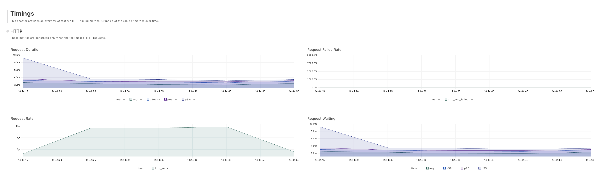
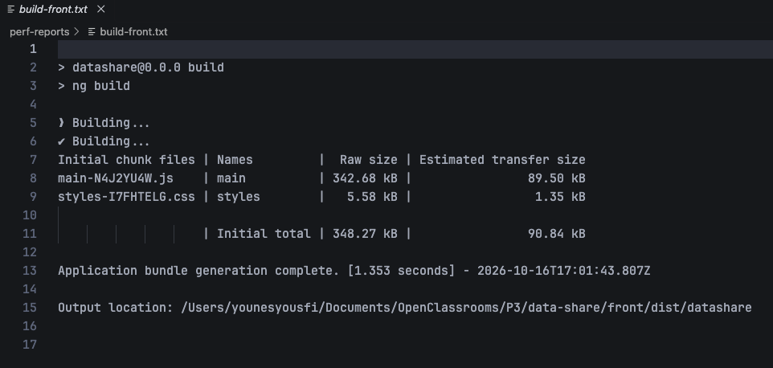
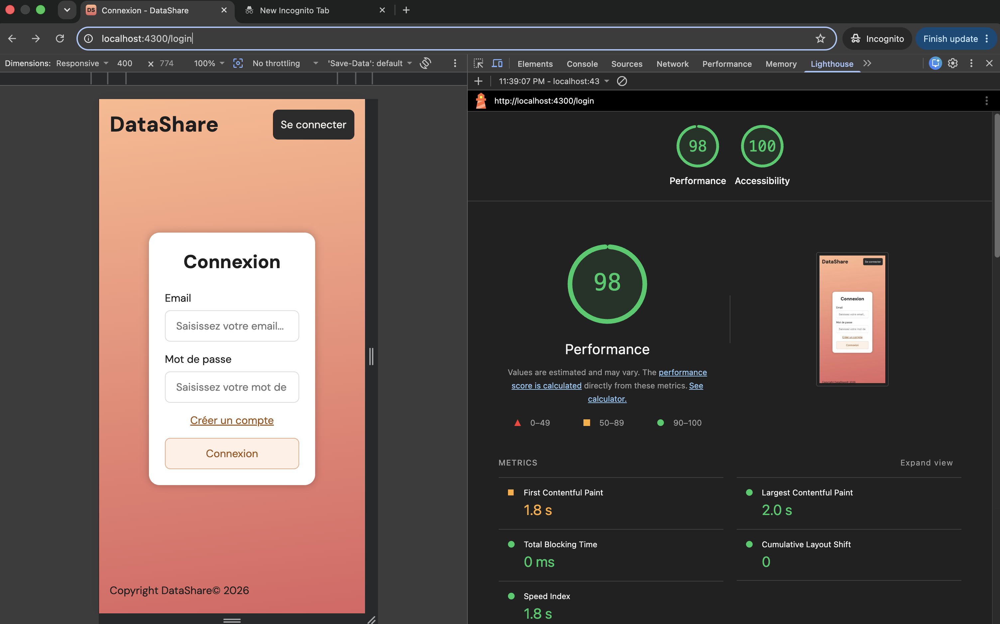
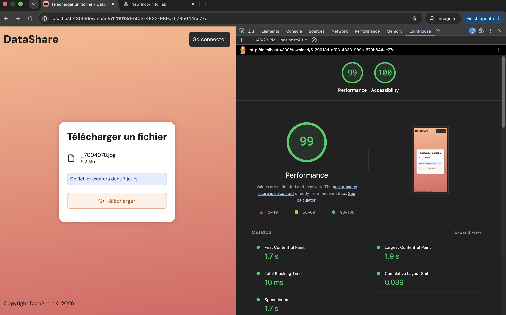

# Performance

Mesures de performance du prototype. Raison de chaque choix :
[`decisions.md`](docs/decisions.md).

**Sommaire** : [Test de charge de l'upload](#test-de-charge-de-lupload-k6) ·
[Limites](#limites-de-la-mesure) · [Relancer le test](#relancer-le-test) ·
[Budget de performance front](#budget-de-performance-front) ·
[Logs structurés et suivi des métriques](#logs-structurés-et-suivi-des-métriques)

## Test de charge de l'upload (k6)

### Ce qu'on teste

`POST /api/files`, l'upload : l'endpoint le plus coûteux de l'application. Chaque requête
vérifie le JWT, reçoit le fichier, l'écrit sur le disque et enregistre sa fiche en base.

| | |
|---|---|
| Script | [`perf/upload.js`](perf/upload.js) |
| Fichier envoyé | 1 Mo, le même à chaque requête |
| Charge | montée de 0 à 10 utilisateurs simultanés en 10 s, 30 s à 10, descente en 10 s |
| Un utilisateur virtuel | envoie un fichier, attend 1 s, recommence |
| Préparation et nettoyage | un compte neuf par exécution ; ses fichiers sont supprimés à la fin |
| Seuils (le test échoue au-delà) | 95 % des uploads en moins de **1 s** · moins de **1 %** d'erreurs |

Repère pour le seuil de 1 s : en dessous, l'utilisateur garde le fil de ce qu'il fait
(Jakob Nielsen, *Response Times: The 3 Important Limits* : 0,1 s paraît instantané,
1 s ne rompt pas le fil, 10 s fait décrocher).

### Résultats

Mesure du 2026-10-16, k6 2.3.0, sur le poste de développement (macOS).

| Mesure | Valeur |
|---|---|
| Uploads envoyés | 400, en 53 s |
| Erreurs | **0** |
| Temps de réponse : médiane / 95 % / maximum | 22 ms / **31 ms** / 95 ms |
| Débit | 7,6 uploads par seconde, 8 Mo/s |
| Seuils | tous deux respectés |



### Lecture

- **Request Rate** : la charge envoyée par k6. Elle monte, reste stable à environ
  10 requêtes par seconde, puis redescend, comme prévu par le script.
- **Request Duration** : le temps de réponse. Il reste entre 20 et 35 ms pendant tout le
  plateau à 10 utilisateurs. Le pic de 90 ms au début correspond aux premières requêtes :
  création du compte de test (BCrypt est volontairement lent) et serveur qui vient de
  démarrer.
- **Request Failed Rate** : 0 % du début à la fin.
- **Request Waiting** : presque identique au temps de réponse. Le temps passé l'est
  côté serveur, le réseau ne compte presque pas (tout tourne sur la même machine).

**Conclusion** : à 10 utilisateurs simultanés, un upload de 1 Mo prend environ 30 ms,
sans erreur, et la charge ne ralentit pas le serveur. Le temps de réponse est 30 fois
sous le seuil.

## Limites de la mesure

| Limite | Conséquence |
|---|---|
| k6, le back et PostgreSQL tournent sur la même machine | ils se partagent processeur et disque : chiffres à lire comme des ordres de grandeur |
| Le serveur n'a pas été poussé à bout | chaque utilisateur passe 98 % de son temps à attendre (1 s de pause pour 20 ms d'envoi) : le débit est fixé par cette pause, pas par le serveur. La capacité maximale n'est **pas** mesurée |
| Fichiers de 1 Mo seulement, alors que la limite est de 1 Go | le comportement avec de gros fichiers n'est pas mesuré ; chaque fichier est écrit deux fois sur le disque (fichier temporaire de Tomcat, puis copie), ce qui pèsera sur les gros envois |
| Pas de réseau réel | sur une connexion à 10 Mbit/s en envoi, ce fichier de 1 Mo met 0,8 s à partir : en conditions réelles, c'est le réseau de l'utilisateur qui fixe la durée, pas le serveur |
| Téléchargement non testé | côté navigateur, le fichier téléchargé tient entier en mémoire avant d'être enregistré (jusqu'à 1 Go) ; k6 n'est pas un navigateur et ne le mesure pas |

Tests prévus pour une mise en production : [`perspectives.md`](docs/perspectives.md).

## Relancer le test

Aucun prérequis de plus que pour lancer l'application : k6 tourne dans Docker, l'image
est téléchargée au premier lancement. Le back doit tourner (voir [`README.md`](README.md)).

Depuis la racine du dépôt :

```bash
mkdir -p ../perf-reports
docker run --rm \
  -v "$PWD/perf:/scripts:ro" \
  -v "$PWD/../perf-reports:/results" \
  -e K6_WEB_DASHBOARD=true \
  -e K6_WEB_DASHBOARD_EXPORT=/results/upload-report.html \
  grafana/k6@sha256:9c2dee7f8ed74d317e4027c06a10f169b625638189de8d4555d0b3486a5aeb34 \
  run /scripts/upload.js
```

| Option | Rôle |
|---|---|
| `perf:/scripts:ro` | le script, en lecture seule |
| `../perf-reports` | rapport HTML (graphiques), écrit **hors du dépôt** : il se régénère à chaque lancement |
| `@sha256:…` | l'image exacte de k6 2.3.0, jamais une version plus récente prise d'office |

Vérification rapide avant la vraie charge (1 utilisateur, 3 envois) : ajouter
`--vus 1 --iterations 3` entre `run` et `/scripts/upload.js`.

Résultat : résumé dans le terminal, section `THRESHOLDS` en tête ; un seuil dépassé
donne un code de sortie non nul, ce qui ferait échouer un pipeline CI.

## Budget de performance front

### Le but

Avant d'afficher une page, le navigateur télécharge l'application (code JavaScript, styles,
police), puis l'exécute. Plus ce paquet est lourd, plus le visiteur attend, surtout sur un
téléphone en 4G.

Le **budget de performance** est une limite de poids fixée à l'avance pour ce paquet.
Chaque build vérifie qu'on reste en dessous. L'application grossit à chaque nouvelle
fonctionnalité : le budget empêche qu'elle s'alourdisse sans que personne ne s'en
aperçoive.

On vérifie deux choses :

| | Question | Outil |
|---|---|---|
| **Le poids** | combien envoie-t-on au navigateur ? | le build Angular et son budget |
| **L'attente** | combien de temps attend un visiteur, sur téléphone ? | Lighthouse, intégré à Chrome |

### Le poids : le bundle

Le *bundle* est ce que produit `npm run build` dans `front/dist/` : notre code TypeScript
traduit en JavaScript, compacté et regroupé en quelques fichiers. C'est ce que le
navigateur télécharge.



**Lire le tableau** :
- `Initial total` : ce qu'il faut télécharger avant le premier affichage ;
- `Raw size` : la taille sur le disque, celle que surveille le budget ;
- `Estimated transfer size` : la taille compressée, celle qui passe vraiment par le
  réseau.

**Résultat** (2026-10-16, Angular 22.2) :

| Fichier | Sur le disque | Sur le réseau |
|---|---|---|
| JavaScript (`main-….js`) | 343 kB | 90 kB |
| Styles (`styles-….css`) | 6 kB | 1 kB |
| **Total initial** | **348 kB** | **91 kB** |
| Police DM Sans (hors tableau Angular) | 28 kB | 28 kB |

- **91 kB, c'est environ 0,5 s** de téléchargement sur une 4G lente (environ 180 kB/s).
- **Un seul fichier JavaScript** : Angular et nos 5 pages arrivent ensemble dès la
  première page.
- **La police** : `dist/media/` contient 8 fichiers de police, mais le navigateur n'en
  télécharge que 2 (normal et gras, alphabet latin) ; les autres sont des versions de
  secours.

**Les seuils** (`front/angular.json`, budget `initial`) :

| Seuil | Valeur | Ce qui se passe au build |
|---|---|---|
| Avertissement | **420 kB** (taille mesurée + 20 %) | le build passe, avec un message jaune `exceeded maximum budget` |
| Erreur | **520 kB** (taille mesurée + 50 %) | le build **échoue** |

Les valeurs par défaut d'Angular (500 kB et 1 MB) sont prévues pour n'importe quelle
application : la nôtre aurait pu tripler de poids sans aucune alerte.
- **+20 %** correspond à une évolution normale (quelques écrans de plus) : on vérifie.
- **+50 %** signale presque toujours une grosse librairie ajoutée sans y penser : on
  bloque.

**Si le budget saute**, pour trouver ce qui pèse (depuis `front/`) :

```bash
npm run build -- --stats-json
```

Puis on dépose `dist/datashare/stats.json` sur
[esbuild.github.io/analyze](https://esbuild.github.io/analyze/) : chaque librairie
apparaît comme un rectangle proportionnel à son poids.

### L'attente : Lighthouse

Lighthouse charge une page en se faisant passer pour un visiteur, chronomètre chaque
étape et donne une note sur 100.

| Réglage | Choix | Pourquoi |
|---|---|---|
| Profil | **mobile** : 4G lente simulée (environ 1,6 Mbit/s), processeur ralenti 4 fois | le pire cas : si la page est rapide ici, elle l'est sur ordinateur |
| Pages | `/login` | la porte d'entrée de tout utilisateur |
| | `/download/:id` | le destinataire d'un lien : il n'a jamais vu le site, rien n'est en cache |
| Catégories | Performance, Accessibilité | SEO écarté : on entre dans DataShare par un compte ou un lien, pas par Google |
| Serveur | le build, servi par nginx | voir [Mesurer le build](#mesurer-le-build-pas-le-serveur-de-dev) |

**Résultats** (2026-10-16, Lighthouse 13.4, Chrome, navigation privée) :

| Mesure | Ce qu'elle dit | `/login` | `/download/:id` | « Bon » selon Google |
|---|---|---|---|---|
| **Score Performance** | synthèse des mesures ci-dessous | **98** | **99** | ≥ 90 |
| First Contentful Paint (FCP) | le premier élément apparaît, l'écran n'est plus blanc | 1,8 s | 1,7 s | ≤ 1,8 s |
| Largest Contentful Paint (LCP) | le contenu principal est affiché | 2,0 s | 1,9 s | ≤ 2,5 s |
| Total Blocking Time (TBT) | la page est « gelée » : on clique et rien ne répond | 0 ms | 10 ms | ≤ 200 ms |
| Cumulative Layout Shift (CLS) | des éléments bougent pendant le chargement | 0 | 0,039 | ≤ 0,1 |
| Poids téléchargé | tout compris (HTML, JS, CSS, police) | 151 kB | 151 kB | — |





**Lecture** :
- Sur un téléphone lent en 4G médiocre, la page s'affiche **en moins de 2 s**, elle ne
  se fige jamais, et rien ne saute à l'écran.
- Le léger décalage (CLS 0,039) sur `/download` : la carte du fichier n'apparaît qu'une
  fois que l'API a répondu (nom, taille), et elle pousse un peu la mise en page.
- 151 kB téléchargés et non 91 kB : nginx compresse au niveau le plus rapide (réglage par
  défaut), donc un peu moins fort que l'estimation d'Angular, et la police s'ajoute.

### Mesurer le build, pas le serveur de dev

La première mesure, faite sur `ng serve` (le serveur de développement), donnait un score
de **55** et **12 s** avant le premier affichage. Ce serveur est conçu pour le
développement : il envoie le code lisible, ni compacté ni compressé, et il ajoute son
outil de rechargement automatique.

| Même page `/login` | Serveur de dev (`ng serve`) | Build servi par nginx |
|---|---|---|
| Poids téléchargé | 2 100 kB | **151 kB** |
| Premier affichage | 11,9 s | **1,8 s** |
| Score | 55 | **98** |

C'est le même code : seul le serveur change. On mesure donc **ce qu'on livrerait** : le
contenu de `front/dist/`, servi par nginx comme le ferait un hébergement. nginx tourne
dans Docker, avec une configuration de mesure d'une dizaine de lignes,
[`perf/nginx.conf`](perf/nginx.conf).

```
Navigateur ──► nginx (Docker, http://localhost:4300)
                ├─ /main-….js, /styles-….css  → fichiers de front/dist/, compressés
                ├─ /login, /download/…        → index.html : Angular affiche la bonne page
                └─ /api/…                     → back Spring Boot (port 8080) → PostgreSQL
```

C'est bien l'application complète, reliée au vrai back et à la vraie base : la page
`/download` affiche un vrai fichier, lu par l'API.

### Pistes d'optimisation

Lighthouse en suggère deux, et le rapport en révèle une troisième. Aucune n'est mise en
place : le score est déjà de 98-99.

| Piste | Le problème | Gain estimé | Quand la mettre en place |
|---|---|---|---|
| **Chargement à la demande** des pages (*lazy loading*) | le visiteur reçoit le code des pages qu'il ne visite pas (environ 50 kB inutilisés à l'arrivée) | environ 0,25 s en 4G lente | quand l'application grossit : le budget l'annoncera |
| **Cache navigateur** | le serveur ne dit pas au navigateur de garder les fichiers : chaque visite retélécharge tout | 2e visite quasi instantanée | au déploiement, dans la configuration du serveur |
| **Compression plus forte** (gzip renforcé ou Brotli) | nginx compresse au plus rapide | environ 30 kB | au déploiement, dans la configuration du serveur |

### Limites de la mesure

| Limite | Conséquence |
|---|---|
| 4G et téléphone **simulés** sur le poste de dev | ordres de grandeur, pas l'expérience exacte d'un vrai téléphone |
| Mesure faite à la main, deux pages | à refaire après une évolution du front ; automatisation dans [`perspectives.md`](docs/perspectives.md) |
| Le score d'un même lancement peut varier de quelques points | deux mesures de `/login` ont donné le même résultat (98) |

### Relancer la mesure

Le back doit tourner (voir [`README.md`](README.md)), et `ng serve` doit être arrêté.

1. Build, depuis `front/` : `npm run build`.
2. nginx, depuis la racine du dépôt :

   ```bash
   docker run --rm -p 4300:80 \
     -v "$PWD/perf/nginx.conf:/etc/nginx/conf.d/default.conf:ro" \
     -v "$PWD/front/dist/datashare/browser:/usr/share/nginx/html:ro" \
     nginx:1.30.6-alpine@sha256:970364228b1e4f932abc22d321932816782cca8a20b85a77552a7cfe9acfb3b5
   ```

   | Option | Rôle |
   |---|---|
   | `-p 4300:80` | le site répond sur `http://localhost:4300` |
   | `nginx.conf` | notre configuration, en lecture seule (`:ro`) |
   | `dist/datashare/browser` | les fichiers du build, en lecture seule |
   | `@sha256:…` | l'image exacte de nginx 1.30.6, jamais une version plus récente prise d'office |

3. Chrome, **fenêtre de navigation privée** (les extensions faussent la mesure), page
   `http://localhost:4300/login`, puis le lien de partage d'un fichier uploadé.
4. Outils de développement (`Cmd + Option + I`) → onglet **Lighthouse** → Mode
   *Navigation*, Device *Mobile*, catégories *Performance* et *Accessibility* →
   **Analyze page load**.
5. Enregistrer le rapport (menu `⋮` → *Save as HTML*) **hors du dépôt**, dans
   `../perf-reports/`.

## Logs structurés et suivi des métriques

### Le problème

Une fois l'application en production, plus de débogueur ni de console sous les yeux :
des milliers de requêtes passent sans que personne les voie. Puis une question arrive :

- un utilisateur : « l'upload est lent depuis hier » ;
- un investisseur : « quel est votre temps de réponse moyen ? quel volume transitez-vous ? » ;
- l'équipe : « reste-t-il des fichiers orphelins sur le disque ? »

**Sans logs**, aucune réponse : il ne reste rien de ce qui s'est passé.

**Avec des logs texte**, la réponse existe mais noyée dans des phrases :

```
POST /api/files 201 23 ms
```

Pour faire une moyenne, il faut une expression régulière qui découpe la phrase, et qui
casse dès que quelqu'un reformule le message.

**Avec des logs structurés**, chaque information est un champ nommé. La réponse tient
en une commande :

```bash
# temps moyen de l'upload
jq -s 'map(select(.path=="/api/files" and .method=="POST") | .durationMs) | add/length' back/logs/datashare.log
```

Et les mêmes fichiers s'envoient tels quels dans un outil de collecte (Elasticsearch,
Grafana Loki) qui trace les courbes et déclenche les alertes.

### L'intérêt en une phrase

**Garder une trace exploitable de ce que fait l'application quand personne ne regarde,
pour répondre après coup à des questions chiffrées.**

Les tests prouvent que l'application marche avant la livraison ; les logs disent comment
elle se comporte une fois en service.

### Ce que ça donne pour DataShare

| Question | Répondue grâce à | Écrit par |
|---|---|---|
| Combien de temps prend un upload ? Lequel est le plus lent ? | `durationMs` de chaque requête | `RequestLoggingFilter` |
| Combien de 401, de 500 aujourd'hui ? | `status` de chaque requête | `RequestLoggingFilter` |
| Quel volume uploadé, téléchargé ? Quelle taille moyenne ? | `sizeBytes` de chaque événement fichier | `FileService` |
| Qu'est-il arrivé au fichier `3f2a…` ? | `fileId` de chaque événement fichier | `FileService` |

### Comment ça marche

```
Requête HTTP ──► RequestLoggingFilter ──► Controller ──► FileService
                 1 ligne par requête                     1 ligne par upload, download, delete
                 method, path, status, durationMs        action, fileId, sizeBytes, accountId
                        │                                       │
                        └───────────────┬───────────────────────┘
                                        ▼
                             Logback (fourni par Spring Boot)
                  console : texte lisible       back/logs/datashare.log : JSON (format ECS)
```

| Qui | Rôle |
|---|---|
| **notre code** (filtre, `FileService`) | crée l'événement et le remplit : `log.atInfo().addKeyValue("durationMs", …)` |
| **SLF4J** | le guichet : reçoit l'événement, sans savoir où il ira |
| **Logback** | l'imprimeur : l'écrit |
| **`application.properties`** | dit à Logback comment et où : console en texte, fichier en JSON |

**Le code dit quoi journaliser, la configuration dit comment et où.** Changer de format
ou de destination ne touche pas au code. La configuration vaut aussi pour les logs de
Spring lui-même (démarrage, erreurs).

Deux lignes réelles du fichier (champs ECS techniques retirés) :

```json
{"@timestamp":"2026-10-17T15:30:55.040Z","log":{"level":"INFO"},"message":"File 0fb4e931-…: upload (1048576 bytes)","action":"upload","fileId":"0fb4e931-…","sizeBytes":1048576,"accountId":28}
{"@timestamp":"2026-10-17T15:30:55.045Z","log":{"level":"INFO"},"message":"POST /api/files 201 44 ms","method":"POST","path":"/api/files","status":201,"durationMs":44}
```

| Champ | Contenu |
|---|---|
| `durationMs` | temps passé **dans le serveur**, de l'arrivée de la requête à la réponse, en millisecondes entières |
| `path` | chemin sans les paramètres d'URL (qui peuvent contenir une donnée sensible) |
| `action` | `upload`, `download` ou `delete` : stable, contrairement au message |
| `sizeBytes` | taille du fichier, en octets |
| `accountId` | propriétaire du fichier, y compris pour un téléchargement (le destinataire est anonyme) |

Ce qui n'est **jamais** journalisé : [`SECURITY.md`](SECURITY.md#journalisation).

### La mesure : une boîte noire

- Le **test de charge k6** (plus haut), c'est le **chronomètre au bord de la piste** : il
  mesure depuis l'extérieur.
- Les **logs**, c'est la **boîte noire** installée dans la voiture : l'application note
  elle-même chacune de ses requêtes.

Pour vérifier la boîte noire et apprendre à la lire, il fallait faire rouler la voiture :

| Outil | Rôle dans cette mesure |
|---|---|
| **k6** | le **volume** : 400 uploads de 1 Mo et 400 suppressions, 10 utilisateurs simultanés |
| **Cypress** (les 3 scénarios E2E) | la **variété** : inscription, connexion ratée, téléchargement, mauvais mot de passe |
| **les logs** | l'**instrument de mesure** : temps de réponse et taille de chaque fichier |
| **[`perf/analyze-logs.sh`](perf/analyze-logs.sh)** | l'**analyse** : 1 654 lignes ramenées à quelques tableaux |

**Ce que la mesure prouve : les logs sont fiables.** Les comptes concordent avec ce qui a
été envoyé : 400 uploads par k6, 400 dans les logs (plus 3 de Cypress) ; 0 erreur pour
k6, aucun `5xx` dans les logs ; les seuls `401` et `403` sont ceux que Cypress provoque
exprès.

### Résultats

Mesure du 2026-10-17, poste de développement, k6 et Cypress lancés en même temps.
Sortie de `./perf/analyze-logs.sh` :

**Temps de réponse côté serveur** (ms)

| Endpoint | Requêtes | Médiane | 95 % | Max |
|---|---|---|---|---|
| `POST /api/files` (upload 1 Mo) | 403 | 18 | **30** | 97 |
| `DELETE /api/files/{id}` | 401 | 1 | 3 | 30 |
| `POST /api/auth/login` | 5 | 74 | — | 108 |
| `POST /api/auth/register` | 4 | 93 | — | 333 |
| `GET /api/files` | 3 | 26 | — | 32 |
| `POST /api/download/{id}` (fichier protégé) | 2 | 75 et 93 | — | — |
| `GET /api/download/{id}` (informations du fichier) | 1 | 8 | — | — |

Pas de 95 % sous une dizaine de requêtes : le chiffre ne voudrait rien dire.

**Statuts** : `200` × 9 · `201` × 407 · `204` × 401 · `401` × 1 · `403` × 1 · aucun `5xx`.

**Fichiers**

| Action | Nombre | Volume total | Taille moyenne |
|---|---|---|---|
| upload | 403 | **400 Mo** | 1 Mo (400 × 1 Mo par k6, 3 × 24 octets par Cypress) |
| delete | 401 | 400 Mo | 1 Mo |
| download | 1 | 24 octets | fichier de test Cypress |

**Le chronomètre et la boîte noire, sur le même upload**

| Upload 1 Mo | Médiane | 95 % | Max |
|---|---|---|---|
| vu par k6 (client) | 22 ms | 36 ms | 102 ms |
| vu par le filtre (serveur) | 18 ms | 30 ms | 97 ms |
| écart = trajet réseau | ~4 ms | ~6 ms | ~5 ms |

### Lecture

1. **L'upload reste rapide sous charge** : 30 ms pour 95 % des envois, 30 fois sous le
   seuil d'une seconde.
2. **Les opérations les plus lentes hachent un mot de passe** (75 à 100 ms) : connexion,
   inscription, téléchargement protégé, même refusé. C'est voulu : BCrypt est lent pour
   freiner les attaques par force brute.
3. **Les uploads les plus lents** (97 et 80 ms) tombent pendant les inscriptions et
   connexions de Cypress : ils se partageaient le processeur avec BCrypt. Concordance
   dans le temps, cohérente, mais pas une preuve.
4. **La première requête** (inscription, 333 ms) est lente parce que le serveur vient de
   démarrer. Classique, sans conséquence.
5. **Chronomètre et boîte noire** : en local, le serveur fait 80 % du temps de réponse,
   le réseau presque rien. En cas de lenteur signalée, comparer les deux dit où chercher :
   serveur rapide → réseau ; serveur lent → code, disque ou base.

### Limites

| Limite | Conséquence |
|---|---|
| Un seul téléchargement mesuré (k6 ne teste que l'upload) | volume téléchargé non représentatif ; test de charge du download en [perspective](docs/perspectives.md) |
| Réseau local | en production, l'envoi de 1 Mo sur une vraie connexion dure bien plus que les 30 ms du serveur (voir [Limites de la mesure](#limites-de-la-mesure)) |
| Millisecondes entières | une requête de 0,9 ms compte pour 0 : sans importance au-delà de quelques ms |
| k6 et Cypress lancés en même temps | ils se gênent un peu : c'est plus proche d'un usage réel, moins d'un test isolé |
| Le script relit tout le fichier | adapté à un prototype, pas à des millions de lignes (voir ci-dessous) |

### En production

On ne lance pas de script à la main. Les logs partent en continu vers un **outil de
collecte** (Grafana Loki, ou la pile Elastic avec Kibana), qui :

- **garde l'historique** de tous les serveurs au même endroit, au-delà des 7 jours du fichier local ;
- **calcule les mêmes chiffres en continu** et les trace en **tableaux de bord** ;
- **déclenche des alertes** : 95 % des uploads au-dessus d'une seconde, apparition de
  `5xx`, orphelin sur le disque ;
- **restreint l'accès** aux logs, qui contiennent les identifiants des fichiers.

Le format ECS est fait pour ça : ces outils le lisent sans configuration. Rien à changer
dans le code, seulement la destination. Détail dans [`perspectives.md`](docs/perspectives.md).

### Pistes d'optimisation

| Constat mesuré | Piste | Quand |
|---|---|---|
| Upload : 30 ms côté serveur pour 1 Mo, mais fichier écrit deux fois sur le disque (fichier temporaire de Tomcat, puis copie) | upload direct vers un stockage objet (URL signée) : le fichier ne traverse plus l'API | gros fichiers, uploads nombreux |
| BCrypt : 75 à 100 ms, l'opération la plus coûteuse en processeur | **ne pas** baisser son coût (c'est la protection) ; limiter le débit de `/api/auth` au niveau du reverse proxy, pour qu'un afflux de connexions ne prive pas les uploads de processeur | toute mise en ligne |
| Première requête lente (333 ms) | ne router le trafic vers le serveur qu'une fois démarré (sonde de santé d'Actuator) | déploiement |
| Suppression (1 ms), informations d'un fichier (8 ms) | rien : déjà négligeable | — |

Le temps serveur n'est pas le goulot : en conditions réelles, c'est le réseau de
l'utilisateur. Les pistes utiles portent donc sur le trajet des fichiers, pas sur le code.

### Relancer l'analyse

Depuis la racine du dépôt (`jq` requis, installé d'office sur macOS récent) :

```bash
./perf/analyze-logs.sh                      # back/logs/datashare.log par défaut
./perf/analyze-logs.sh autre-fichier.log    # un autre log, ex. celui des tests
```

Pour une mesure propre :

1. Vider le log, **back lancé** : `: > back/logs/datashare.log` (jamais `rm`, voir
   [`MAINTENANCE.md`](MAINTENANCE.md#logs)).
2. Générer du trafic : k6 ([Relancer le test](#relancer-le-test)), puis `npm run e2e`
   depuis `front/` (front lancé).
3. Lancer le script.

Les tests automatisés (`./mvnw verify`) écrivent dans `back/target/test-logs/`, jamais
dans le log de l'application.
