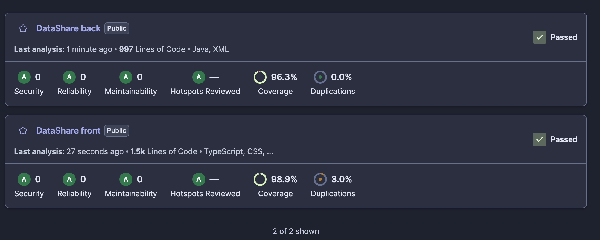
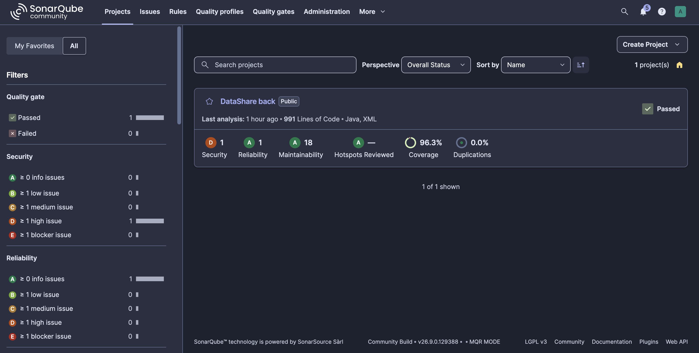
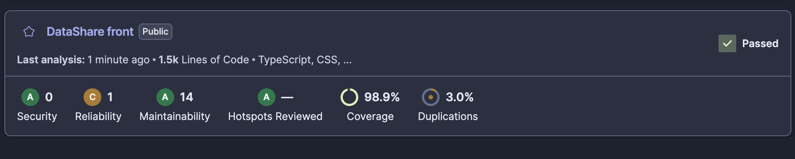
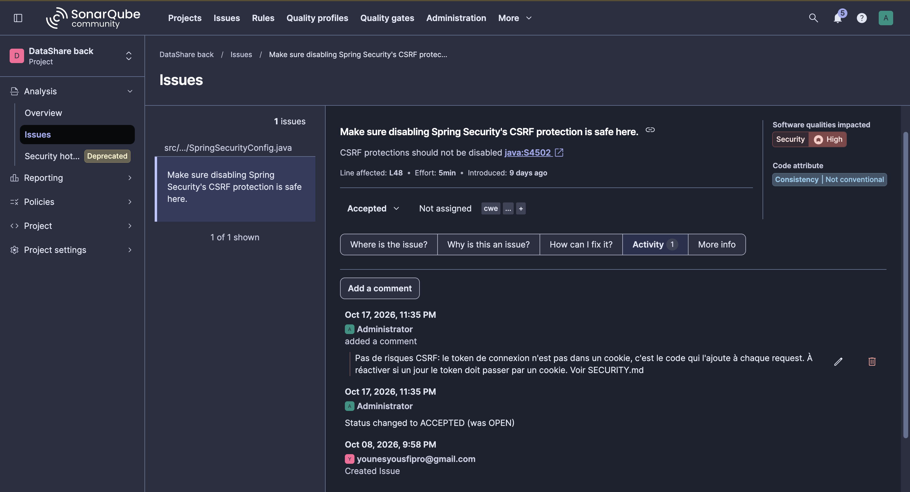
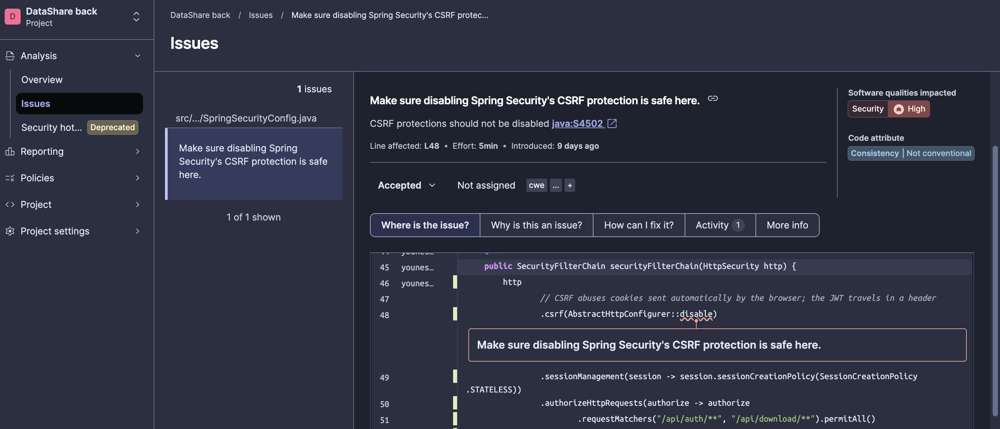

# Sécurité

Politique de sécurité du prototype (US01 à US06), mise en œuvre au fil des user
stories, puis résultats des scans. Détail technique :
[`architecture.md`](docs/conception/architecture.md) ; raison de chaque choix :
[`decisions.md`](docs/decisions.md).

**Sommaire** : [Politique de sécurité](#politique-de-sécurité-de-lapplication) ·
[Scan des dépendances](#scan-des-dépendances) ·
[Analyse du code](#analyse-du-code-sonarqube) · mise à jour des dépendances :
[`MAINTENANCE.md`](MAINTENANCE.md)

## Politique de sécurité de l'application

### Authentification et accès

| Règle | Mise en œuvre |
|---|---|
| Routes publiques : inscription, connexion, téléchargement par lien | `/api/auth/**`, `/api/download/**` |
| Routes publiques techniques : description de l'API, sonde de santé | Swagger UI (`/swagger-ui/**`, `/v3/api-docs/**`, `/v3/api-docs.yaml`) ; `/actuator/health` seul, qui répond `UP` ou `DOWN` sans détail. Les autres routes Actuator restent protégées |
| Toutes les autres exigent un JWT | `Authorization: Bearer <jeton>` ; signature (HS256) et expiration vérifiées à chaque requête, sinon `401` |
| Le JWT porte l'identifiant du compte, valable 1 h | clé de signature dans `.env`, jamais versionnée ; l'API refuse de démarrer sans elle |
| L'identité est lue dans le JWT, jamais dans la requête | personne ne peut déposer, lister ou supprimer au nom d'un autre compte |
| Fichier d'un autre compte : `404`, comme un fichier inexistant | son existence n'est pas révélée |
| Lien de partage = UUID aléatoire (122 bits) | impossible à deviner ou à énumérer |

### Mots de passe

| | Compte | Fichier (optionnel) |
|---|---|---|
| Longueur | 8 à 18 caractères | 6 à 18 caractères |
| Stockage | empreinte BCrypt salée, jamais le mot de passe | idem |
| Transmission | corps d'un `POST` | corps d'un `POST` au téléchargement, jamais dans l'URL (qui finit dans les logs et l'historique) |

18 caractères au plus : BCrypt ne lit que 72 octets, et un caractère en occupe jusqu'à 4.
Un mot de passe de fichier faux donne `403`, pas `401` : le front traite `401` comme une
session expirée et déconnecterait l'utilisateur.

### Fichiers déposés

| Règle | Pourquoi |
|---|---|
| 1 Go maximum, sinon `413` | limite des spécifications |
| Extensions refusées : `exe`, `com`, `msi` (exécutables Windows) · `bat`, `cmd`, `ps1`, `vbs`, `sh` (scripts) · `jar` (programme Java) | vecteurs classiques de logiciels malveillants |
| Seule la dernière extension compte, casse ignorée | `facture.pdf.EXE` est refusé ; `archive.exe.zip` accepté |
| Nom obligatoire, 255 caractères au plus | taille de la colonne : une requête forgée finirait sinon en `500` |
| Sur le disque, le fichier porte son UUID, jamais son nom d'origine | un nom piégé (`../../config`) ne peut pas faire écrire hors du dossier de stockage (*path traversal*) |
| Expiration de 1 à 7 jours ; fichier expiré refusé (`410`), effacé du disque chaque nuit | un lien ne reste pas valable indéfiniment |
| Téléchargé en pièce jointe, toujours en `application/octet-stream`, avec `nosniff` | un fichier `.html` ou `.svg` déposé est enregistré par le navigateur, jamais affiché ni exécuté sous notre domaine |
| Chaque règle est contrôlée par le front **et** par l'API | le front se contourne (`curl`) : seule l'API fait foi |

La spécification laisse la liste « à définir selon la politique de sécurité ». Elle
reprend le cœur de celle de Gmail, référence pour les pièces jointes, plus `sh` pour
Linux et macOS :

| | Types refusés | Contrôle dans les archives |
|---|---|---|
| WeTransfer | aucun | — |
| **DataShare** | 9 extensions : exécutables et scripts | non |
| Gmail | plus de 50 extensions | oui |

### Ce que l'API ne révèle pas

| Information | Protection |
|---|---|
| empreintes des mots de passe | jamais renvoyées : la fiche d'un fichier indique seulement s'il est protégé |
| propriétaire d'un fichier partagé | la page de téléchargement ne reçoit que nom, taille, expiration et « protégé » : ni identifiant, ni date d'envoi, ni compte |
| emails inscrits, à la connexion | même message que l'email ou le mot de passe soit faux |
| valeurs saisies refusées | une erreur de validation cite le champ, jamais la valeur (ce peut être un mot de passe) |
| erreurs internes | `500` et message générique ; le détail reste dans les logs du serveur |

Côté navigateur : pas de CORS (front et API sous une même origine), CSRF désactivé car
le JWT voyage dans un en-tête et non dans un cookie, en-têtes de protection de Spring
Security conservés. Détail dans [`architecture.md`](docs/conception/architecture.md),
section « Sécurité : rôle de chaque couche ».

### Journalisation

Les logs (détail dans [`PERF.md`](PERF.md#logs-structurés-et-suivi-des-métriques))
servent à diagnostiquer ; ils ne doivent pas devenir une fuite.

| Jamais journalisé | Pourquoi |
|---|---|
| mots de passe (compte, fichier) et leurs empreintes | un log se copie, s'archive, se transmet : un secret n'a rien à y faire |
| JWT | un jeton lu dans un log permet d'agir au nom du compte |
| emails | donnée personnelle (RGPD) : le compte est désigné par son identifiant numérique |
| paramètres d'URL | ils peuvent porter une donnée sensible : seul le chemin est noté |
| contenu et nom des fichiers | ils appartiennent à l'utilisateur ; seuls l'identifiant et la taille sont notés |

**Point d'attention : l'identifiant du fichier (`fileId`) est journalisé**, et c'est
aussi son lien de partage. Qui lit les logs peut télécharger les fichiers non protégés
encore valides. On le garde parce qu'il est indispensable au diagnostic (retrouver un
orphelin sur le disque, suivre un fichier). La parade est l'accès : `back/logs/` est
ignoré par Git, et en production les logs vont dans un outil de collecte à accès
restreint ([`perspectives.md`](docs/perspectives.md)).

### Limites connues

| Limite | Conséquence | Piste d'évolution |
|---|---|---|
| Liste noire d'extensions | contournable par un renommage ou une archive | antivirus côté serveur |
| `409` à l'inscription | révèle qu'un email est déjà inscrit | confirmation par email, hors MVP |
| JWT dans `localStorage` | lisible par un script injecté dans la page (XSS) ; Angular échappe par défaut ce qu'il affiche | cookie `HttpOnly` (CSRF à réactiver) |
| Déconnexion côté front seulement | un jeton copié reste valable jusqu'à son expiration (1 h au plus) | liste de jetons révoqués |
| Mot de passe limité à 18 caractères | sous les 64 recommandés par l'OWASP et le NIST | compter les octets, ou Argon2 |
| Swagger UI public | décrit toutes les routes à n'importe qui (les routes protégées le restent) | le couper en production : `springdoc.api-docs.enabled=false`, `springdoc.swagger-ui.enabled=false` |
| HTTP en développement | aucun chiffrement | reverse proxy HTTPS ([`perspectives.md`](docs/perspectives.md)) |

## Scan des dépendances

Dernier scan : **16 octobre 2026**. Le relancer : [`MAINTENANCE.md`](MAINTENANCE.md).

### En bref

| Cible | Avant correction | Après |
|---|---|---|
| Front, `npm audit` (580 paquets, dont 12 livrés au navigateur) | 0 faille | 0 |
| Front, Trivy | 0 faille | 0 |
| **Back, Trivy** | **10 failles** : 3 CRITICAL, 5 HIGH, 2 MEDIUM | **0** |
| Secrets dans le dépôt, Trivy | 0 | 0 |

### Outils

Un scanner ne lance pas l'application : il liste les bibliothèques utilisées, versions
exactes et dépendances indirectes comprises (`package-lock.json`, `pom.xml`), et les
compare à une base de failles publiées (CVE).

| Outil | Analyse | Pourquoi lui |
|---|---|---|
| `npm audit` | dépendances du front | fourni avec npm ; `--omit=dev` isole ce qui part dans le navigateur |
| Trivy 0.75.0 | dépendances du back et du front, secrets | seul des deux à lire Maven ; cité par la consigne |

**Trivy lui-même est une dépendance à risque** : en mars 2026, des versions piégées
(0.69.4 à 0.69.6) ont volé les secrets des machines qui les lançaient. Il tourne donc
dans Docker, en version figée par son empreinte (`sha256`), avec le dépôt monté en
lecture seule. Alternatives écartées : [`decisions.md`](docs/decisions.md).

### Failles trouvées et décisions

Toutes dans le back, dans deux bibliothèques fournies par Spring Boot 4.1.1 :

| Bibliothèque | Failles | Atteignable chez nous ? | Décision |
|---|---|---|---|
| Tomcat 11.0.24 (serveur web embarqué) | 3 CRITICAL : contournement de ses règles d'accès et de ses authentifications DIGEST et FORM | **non** : ces mécanismes ne sont pas utilisés, l'accès est contrôlé par Spring Security et le JWT | mise à jour en 11.0.25 : correctif sans coût, et l'exposition dépend d'une configuration qui peut changer |
| Jackson 3.1.5 (lecture du JSON des requêtes) | 5 HIGH, 2 MEDIUM : déni de service par un JSON piégé | **oui** : `/api/auth/**` lit du JSON envoyé sans compte | mise à jour en 3.1.7 |

**Correction** : Spring Boot fixe ces versions, et sa version corrective (4.1.2) n'est
pas encore publiée. `pom.xml` redéfinit donc `tomcat.version` et `jackson-bom.version`,
mécanisme prévu par Spring Boot, à retirer au passage à 4.1.2.

**Vérification** : 93 tests back passés ; le `.jar` livré contient
`tomcat-embed-core-11.0.25` et `jackson-databind-3.1.7` ; nouveau scan à 0 faille.

### Ce que le scan ne couvre pas

| Angle mort | Conséquence |
|---|---|
| failles pas encore publiées | un scan à 0 vaut pour ce jour-là : d'où un scan régulier ([`MAINTENANCE.md`](MAINTENANCE.md)) |
| secrets de format inconnu | la clé JWT, chaîne aléatoire, ne serait pas reconnue : elle est protégée par `.gitignore`, pas par le scan |
| notre propre code | seules les bibliothèques sont analysées ; notre code l'est par SonarQube ([section suivante](#analyse-du-code-sonarqube)) |

## Analyse du code (SonarQube)

Dernière analyse : **17 octobre 2026**. La relancer, et le détail qualité (dette,
duplication) : [`MAINTENANCE.md`](MAINTENANCE.md#qualité-du-code-sonarqube).

Le scan des dépendances regarde les bibliothèques. SonarQube lit **notre code**, sans
l'exécuter, et le confronte à ses règles (analyse statique, ou SAST) : failles, bugs
probables, code difficile à maintenir.

### En bref

| | Avant | Après |
|---|---|---|
| Back (environ 1 000 lignes) | Security **D** : 1 remarque de gravité *high* ; 19 remarques en tout | A partout, 0 remarque ouverte |
| Front (environ 1 500 lignes) | Security A ; 15 remarques en tout, dont aucune de sécurité | A partout, 0 remarque ouverte |
| *Security hotspots* (code sensible à faire relire) | 0 | 0 |

Avant corrections

### La remarque de sécurité : CSRF désactivé

SonarQube ne dit pas « c'est une faille », il dit « vérifiez que c'est sans danger ».
Décision : **acceptée**, sans changer le code.

| Question | Réponse |
|---|---|
| Ce que fait l'attaque | un site piégé envoie une requête vers notre API ; le navigateur y joint **tout seul** les cookies de l'utilisateur |
| Pourquoi elle échoue chez nous | aucun cookie : le JWT est ajouté par notre code dans l'en-tête `Authorization`, un autre site ne peut ni le lire ni l'envoyer |
| Quand la décision tombe | si le jeton passe dans un cookie `HttpOnly` ([Limites connues](#limites-connues)) : réactiver la protection CSRF |

La décision est tracée dans l'outil : statut *Accepted*, auteur, date et raison.

La ligne visée dans le code

### Ce que l'analyse ne couvre pas

| Angle mort | Parade |
|---|---|
| suivi d'une donnée de l'utilisateur jusqu'à un point dangereux (*analyse de taint* : injection SQL, *path traversal*) | absent de l'édition gratuite (Community Build). Risques traités par conception : requêtes JPA paramétrées, fichiers stockés sous leur UUID et jamais sous le nom reçu ([Fichiers déposés](#fichiers-déposés)). Outil dédié : [`perspectives.md`](docs/perspectives.md) |
| erreurs de logique (un compte qui accède au fichier d'un autre) | tests d'intégration ([`TESTING.md`](TESTING.md)) |
| bibliothèques | [scan des dépendances](#scan-des-dépendances) |
