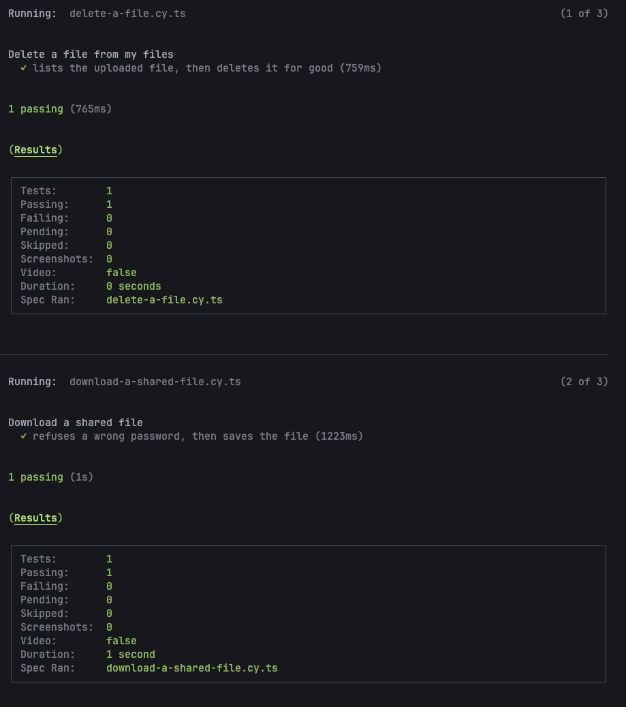
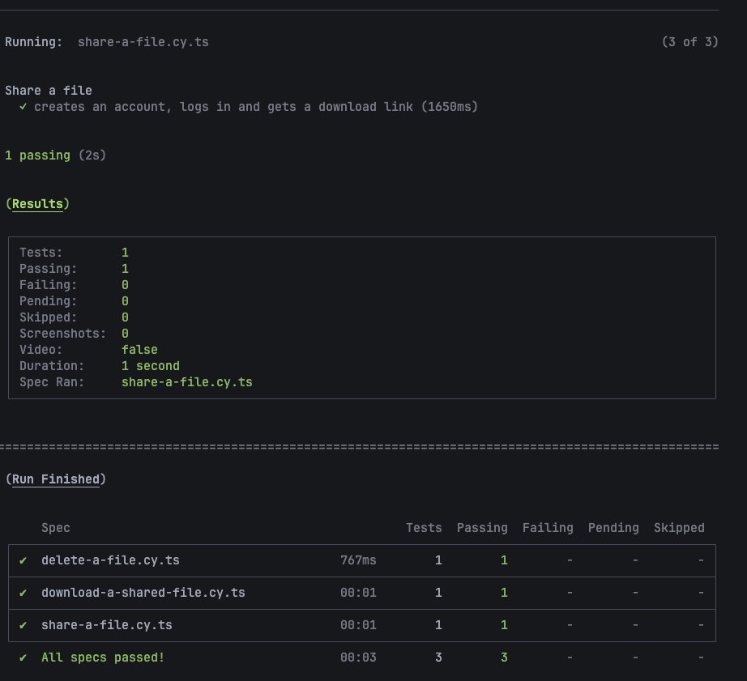
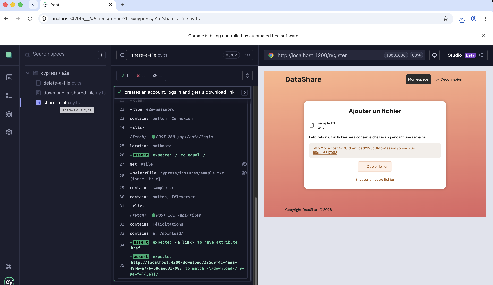
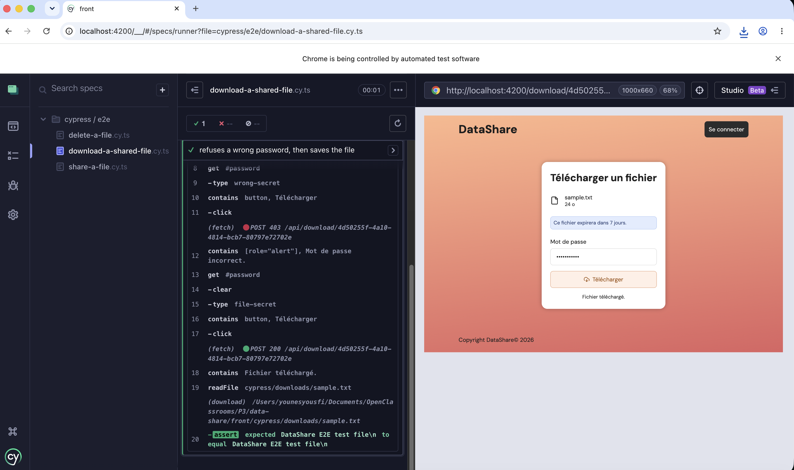
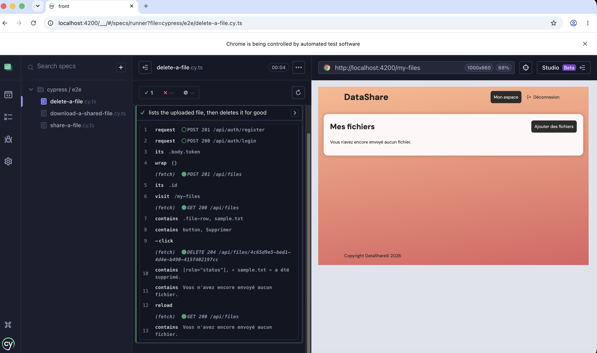
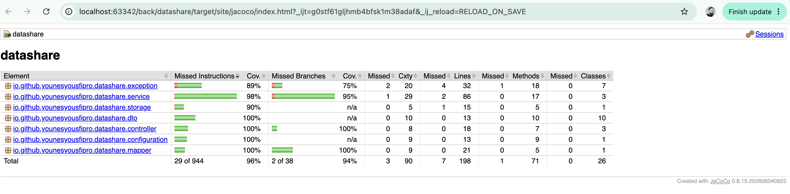
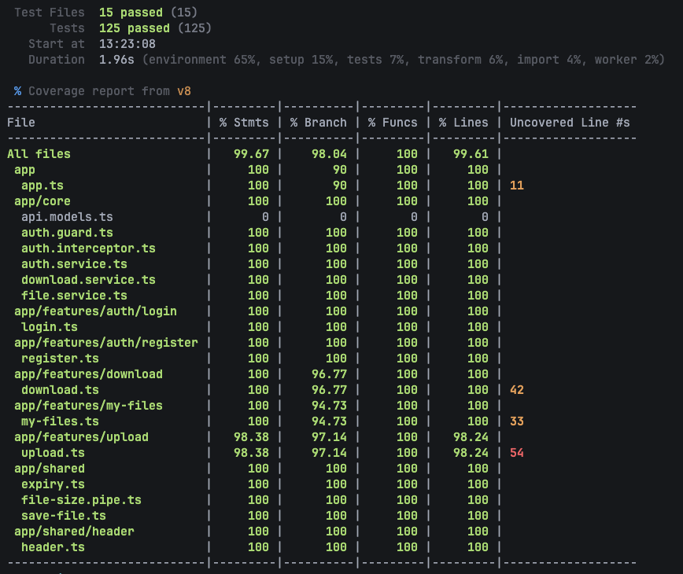

# Tests

Stratégie de test de DataShare, tenue à jour à chaque user story.

## Niveaux de test

| Niveau | Outil | Vérifie | Dépendances réelles |
|---|---|---|---|
| Unitaire back | JUnit 5, Mockito, AssertJ | les règles d'un service, isolé | aucune : base et disque remplacés par des doublures |
| Intégration back | Spring Boot Test, MockMvc, Testcontainers | une route de bout en bout : sécurité, validation, codes HTTP, base | PostgreSQL 18 en conteneur, migré par Flyway |
| Unitaire front | Vitest | composants et services Angular | aucune : API simulée |
| E2E | Cypress | un parcours utilisateur complet dans le navigateur | toutes : front, API, base de dev, disque |
| Performance | k6 | temps de réponse d'un endpoint critique sous charge | voir `PERF.md` |

**Convention back** : un service est testé en **unitaire** (ses règles, isolées) ; un
controller en **intégration** (la chaîne complète). Un controller ne fait que relier HTTP au service.

**Convention front** : un service est testé contre un faux serveur HTTP
(`HttpTestingController`) ; un composant est testé **par son HTML** (on remplit un champ,
on lit le message affiché), avec des services simulés (`vi.fn()`).

## Fonctionnalités critiques

Identifiées avant le développement : ce sont elles que les tests doivent couvrir en
priorité, et en échec comme en succès.

| Fonctionnalité | US | Risque si elle casse | Tests prévus |
|---|---|---|---|
| Inscription : email unique, mot de passe haché | US03 | comptes en double, mots de passe lisibles en base | unitaire + intégration |
| Connexion : JWT, même message d'erreur que l'email ou le mot de passe soit faux | US04 | accès impossible, ou liste des comptes devinable | unitaire + intégration + E2E |
| Routes protégées : `401` sans JWT valide | US01 (jeton émis par US04) | données d'un compte accessibles sans connexion | intégration |
| Droits sur les fichiers : un compte ne voit ni ne supprime les fichiers d'un autre (`404`) | US05, US06 | fuite ou perte de fichiers d'autrui | intégration |
| Envoi : 1 Go max, extensions refusées, durée de 1 à 7 jours, mot de passe de 6 à 18 caractères | US01 | fichiers dangereux ou hors limites stockés | unitaire + intégration + E2E |
| Téléchargement : `410` si expiré, `403` si mot de passe faux | US02 | fichier accessible après expiration ou sans son mot de passe | unitaire + intégration + E2E |
| Suppression physique : fiche et fichier effacés | US06 | fichier conservé alors que l'utilisateur le croit supprimé | unitaire + intégration + E2E |

## Scénarios E2E

Trois parcours tirés des fonctionnalités critiques, joués sur la **vraie application** :
rien n'est simulé, c'est le seul niveau qui relie le front, l'API, la base et le disque.

| Scénario | Fichier (`front/cypress/e2e/`) | US | Critères d'acceptation |
|---|---|---|---|
| Partager un fichier | `share-a-file.cy.ts` | US03, US04, US01 | compte créé : « compte créé » sur `/login` · mauvais mot de passe : « Email ou mot de passe incorrect. » · connecté : arrivée sur l'accueil · fichier envoyé : lien `/download/<uuid>` affiché |
| Télécharger un fichier protégé | `download-a-shared-file.cy.ts` | US02 | page ouverte **sans compte** · mauvais mot de passe : « Mot de passe incorrect. » · bon mot de passe : fichier enregistré, **contenu identique** à l'original |
| Supprimer un fichier | `delete-a-file.cy.ts` | US05, US06 | fichier listé dans « Mes fichiers » · confirmation qui nomme le fichier · ligne retirée, suppression annoncée · **après rechargement**, toujours absent : l'API ne le renvoie plus |

**Données** : chaque test crée son propre compte (`e2e-<horodatage>@test.local`), sans
dépendre des autres tests ni du contenu de la base. Ce qu'un test ne vérifie pas (compte
et upload des scénarios 2 et 3) est préparé par l'API (`cypress/support/api.ts`).

**Hors E2E** : l'expiration (`410`) demanderait d'attendre des jours ; elle est couverte
en unitaire et en intégration.

**Résultats** (exécution du 2026-10-16) : 3 scénarios sur 3 passent, en 3 secondes.

Détail de chaque scénario dans l'interface Cypress

## Couverture

Seuil de **70 %** sur les quatre métriques (instructions, lignes, branches, méthodes),
mesuré **séparément** pour le back (JaCoCo) et le front (Vitest). Sous le seuil, la
commande échoue (décision du 2026-10-07).

**Résultats** (mesure du 2026-10-16) :

| | Instructions | Branches | Lignes | Méthodes |
|---|---|---|---|---|
| Back (JaCoCo) | 96 % | 94 % | 96 % | 98 % |
| Front (Vitest, 127 tests) | 99,7 % | 98 % | 99,6 % | 100 % |

SonarQube, qui relit ces deux rapports, affiche des valeurs cohérentes : **96,3 %** (back) et
**98,9 %** (front), en un seul chiffre qui combine lignes et branches. Il applique les
mêmes exclusions, plus `main.ts`, hors du périmètre de Vitest (`src/app/`), qu'il
compterait sinon à 0 % ([`MAINTENANCE.md`](MAINTENANCE.md#qualité-du-code-sonarqube)).

**Exclu de la mesure** — uniquement du code sans logique :

| Côté | Exclu | Raison |
|---|---|---|
| Back | `DatashareApplication` | point d'entrée : une ligne qui démarre Spring |
| Back | code généré par Lombok (accesseurs, constructeurs) | marqué `@Generated` par `lombok.config` ; seul le code écrit à la main est mesuré |
| Front | `app.config.ts`, `app.routes.ts` | déclarations de configuration, sans branchement |

## Exécution

| Commande | Depuis | Produit |
|---|---|---|
| `./mvnw verify` | `back/` | tests unitaires et d'intégration (Docker requis), rapport `target/site/jacoco/index.html`, contrôle du seuil ; logs des tests dans `target/test-logs/` |
| `npm run test:coverage` | `front/` | tests Vitest, rapport `coverage/` et contrôle du seuil |
| `npm run e2e` | `front/`, back (`./mvnw spring-boot:run`) et front (`npm start`) lancés | les 3 scénarios E2E, navigateur sans fenêtre ; captures des échecs dans `cypress/screenshots/` |
| `npm run e2e:open` | idem | interface Cypress : chaque étape rejouée à l'écran |

## Tests par user story

### US03 — Création de compte

| Test | Niveau | Cas couverts |
|---|---|---|
| `AuthServiceTest` | unitaire | email enregistré en minuscules et mot de passe haché · email déjà pris refusé sans enregistrement · email pris par une inscription simultanée (contrainte d'unicité) |
| `AuthControllerTest` | intégration | `201` et hash BCrypt en base · `409` même avec une casse différente, au format `ErrorDetailsDTO` · `400` : email invalide, email entouré d'espaces, mot de passe trop court (sans renvoyer la valeur), mot de passe de plus de 18 caractères, JSON mal formé |
| `auth.service.spec.ts` (front) | unitaire | `POST /api/auth/register` avec l'email et le mot de passe |
| `register.spec.ts` (front) | unitaire | aucune erreur avant de quitter un champ · formulaire vide : trois erreurs · email mal formé, erreur reliée au champ (`aria-invalid`, `aria-describedby`) · espaces retirés de l'email · mot de passe hors 8 à 18 caractères · confirmation différente · aucun appel si le formulaire est invalide · envoi de l'email et du mot de passe seuls, puis redirection vers `/login?registered=true` · `409` : « email déjà utilisé » · autre erreur : message générique · double clic : une seule requête |

### US04 — Connexion

| Test | Niveau | Cas couverts |
|---|---|---|
| `JwtServiceTest` | unitaire | jeton relu avec la même clé : `sub` = identifiant du compte, expiration 1 heure après l'émission |
| `AuthServiceTest` | unitaire | jeton renvoyé quelle que soit la casse de l'email · email inconnu et mot de passe faux refusés, sans émettre de jeton |
| `AuthControllerTest` | intégration | `200` + jeton · `401` au même message pour email inconnu et mot de passe faux · `401` (et non `500`) pour un mot de passe de plus de 72 octets, limite de BCrypt · `400` email invalide |
| `auth.service.spec.ts` (front) | unitaire | `POST /api/auth/login` : jeton enregistré, `isLoggedIn` vrai · `401` : rien n'est enregistré · jeton déjà présent au démarrage : connecté |
| `login.spec.ts` (front) | unitaire | message « compte créé » seulement avec `?registered=true` · message « session expirée » avec `?expired=true` · formulaire vide : deux erreurs · email mal formé, erreur reliée au champ · espaces retirés de l'email · mot de passe court accepté (longueur contrôlée à l'inscription) · aucun appel si le formulaire est invalide · envoi puis redirection vers `/` · `401` : « email ou mot de passe incorrect » · autre erreur : message générique · double clic : une seule requête |
| `header.spec.ts` (front) | unitaire | « Se connecter » vers `/login` si déconnecté · bascule sur « Mon espace » dès la connexion, sans recréer le composant |

### US01 — Upload (back)

| Test | Niveau | Cas couverts |
|---|---|---|
| `LocalFileStorageTest` | unitaire, vrai disque (dossier temporaire) | dossier créé au démarrage · fichier écrit sous son UUID · fichier existant jamais écrasé · effacement · effacement d'un fichier absent sans erreur · erreur disque remontée |
| `FileMapperTest` | unitaire | champs recopiés, hash jamais exposé (`passwordProtected`) · statut `ACTIVE`, `EXPIRING_SOON` (moins de 24 h), `EXPIRED` |
| `FileServiceTest` | unitaire | disque **puis** base, sous le même UUID · 7 jours par défaut, durée choisie appliquée · seul le hash du mot de passe enregistré · extensions interdites refusées avant toute écriture (`exe`, `.pdf.EXE`, `sh`, `jar`) · noms acceptés (sans extension, `.exe.zip`) · nom vide ou de plus de 255 caractères refusé · échec de la base : fichier effacé et erreur d'origine remontée |
| `RestExceptionHandlerTest` | unitaire | fichier de plus de 1 Go : `413` au format `ErrorDetailsDTO` (MockMvc ne passe pas par la limite de taille, d'où un test direct du gestionnaire) |
| `FileControllerTest` | intégration | `201` : fiche sans hash ni `accountId`, rattachée au compte du jeton, fichier présent sur le disque · `401` sans jeton, jeton falsifié, jeton expiré · `400` : extension interdite (rien d'enregistré), mot de passe trop court (sans renvoyer la valeur), durée hors limites, fichier absent |

Les tests reçoivent une clé JWT factice et un dossier de stockage dans
`target/test-uploads` par la configuration Maven (Surefire) : ils tournent sans `.env`
et ne touchent pas aux fichiers de dev.

### US02 — Téléchargement (back)

| Test | Niveau | Cas couverts |
|---|---|---|
| `LocalFileStorageTest` | unitaire, vrai disque | fichier relu tel qu'écrit · fichier absent : erreur |
| `FileMapperTest` | unitaire | métadonnées publiques recopiées, hash réduit à `passwordProtected` |
| `FileServiceTest` | unitaire | inconnu → `404`, expiré → `410` (même avec un mot de passe faux) · mot de passe absent, vide, faux ou de casse différente → `403` · bon mot de passe, ou fichier non protégé sans mot de passe → contenu · **à chaque refus, le fichier n'est jamais ouvert** |
| `DownloadControllerTest` | intégration, **sans JWT** | métadonnées sans id, date d'envoi, propriétaire ni hash · `200` avec ou sans corps, fichier en pièce jointe, `application/octet-stream`, `Content-Length`, `nosniff` · nom accentué encodé en UTF-8 · `403`, `404`, `410` au format `ErrorDetailsDTO` · `400` : identifiant qui n'est pas un UUID, mot de passe de plus de 18 caractères (sans renvoyer la valeur) · `415` pour un corps en texte brut, avec le message de Spring (et non un message générique) |

### US05 — Historique (back)

| Test | Niveau | Cas couverts |
|---|---|---|
| `FileServiceTest` | unitaire | fiches dans l'ordre du repository, expirées comprises, statut et `passwordProtected` calculés · aucun fichier → liste vide |
| `FileControllerTest` | intégration | seulement les fichiers du compte du jeton (pas ceux d'un autre compte) · **triés par la base**, le plus récent d'abord · fichier expiré listé en `EXPIRED` · ni hash ni `accountId` · `401` sans jeton |

### US06 — Suppression (back)

| Test | Niveau | Cas couverts |
|---|---|---|
| `FileServiceTest` | unitaire | fiche effacée **puis** fichier sur le disque · fichier expiré supprimable · fichier d'un autre compte : `404`, rien d'effacé · fichier inconnu : `404` · échec du disque : aucune erreur remontée, fiche effacée (orphelin journalisé) |
| `FileControllerTest` | intégration | `204` : fiche absente de la base **et** fichier absent du disque · fichier d'un autre compte : `404`, fiche et fichier intacts · fichier inconnu : `404` · `400` identifiant qui n'est pas un UUID · `401` sans jeton, rien d'effacé |

### Journalisation (back)

| Test | Niveau | Cas couverts |
|---|---|---|
| `RequestLoggingFilterTest` | unitaire, logs capturés en mémoire (`ListAppender` de Logback) | méthode, chemin, statut et durée écrits en **champs** (ce qui part dans le JSON) · paramètres d'URL absents du chemin · statut lu après le passage dans le controller · requête qui lève une exception : ligne écrite quand même |

Les événements fichiers de `FileService` (upload, download, delete) sont exécutés par
ses tests ; leur contenu réel est vérifié sur le log de l'application
([`PERF.md`](PERF.md#logs-structurés-et-suivi-des-métriques)).

### Description de l'API et sonde de santé (back)

| Test | Niveau | Cas couverts |
|---|---|---|
| `OpenApiDocsTest` | intégration | description de l'API (JSON et YAML) et Swagger UI accessibles sans jeton · routes `/api/files` marquées protégées, `/api/download` non |
| `HealthCheckTest` | intégration | `/actuator/health` sans jeton : `UP`, sans détail sur la base ni le disque |

### US01 — Upload (front)

| Test | Niveau | Cas couverts |
|---|---|---|
| `auth.interceptor.spec.ts` | unitaire | jeton envoyé aux routes protégées · aucun jeton vers `/api/auth/**` et `/api/download/**` · requête inchangée sans jeton · `401` d'une route protégée : jeton effacé, redirection vers `/login?expired=true`, erreur transmise à la page · `401` de `/api/auth/login` laissé à la page · autre erreur : jeton conservé |
| `auth.guard.spec.ts` | unitaire, vrai routeur | page affichée avec un jeton · sans jeton, redirection vers `/login` |
| `app.routes.spec.ts` | unitaire, vraies routes de l'application | URL inconnue : redirection vers l'accueil |
| `auth.service.spec.ts` | unitaire | `logout` : jeton effacé, `isLoggedIn` faux |
| `file.service.spec.ts` | unitaire | `POST /api/files` en multipart : fichier, mot de passe, durée · aucun champ `password` si le mot de passe est vide |
| `file-size.pipe.spec.ts` | unitaire | octets, puis Ko, Mo, Go par paliers de 1024, une décimale à la française |
| `upload.spec.ts` | unitaire | accueil, sélecteur ouvert par « Choisir » et « Changer » · nom et taille du fichier · annulation du sélecteur : fichier conservé · 1 Go pile accepté, 1 Go + 1 octet refusé (bouton désactivé) · dernière extension interdite refusée quelle que soit la casse, `.exe.zip` et fichier sans extension acceptés · 7 jours par défaut · envoi du mot de passe et de la durée choisis · mot de passe de 5 ou 19 caractères refusé · fichier refusé jamais envoyé · double clic : une seule requête, message d'envoi · durée de conservation annoncée · lien `/download/<id>` affiché et copié, message si la copie est refusée · « Envoyer un autre fichier » : formulaire vierge · `413`, `400`, autre erreur : message adapté, nouvel essai possible |

### US02 — Téléchargement (front)

| Test | Niveau | Cas couverts |
|---|---|---|
| `download.service.spec.ts` | unitaire | `GET /api/download/<id>` : métadonnées · `POST` avec le mot de passe, réponse lue en `Blob` · aucun champ `password` si le mot de passe est vide |
| `save-file.spec.ts` | unitaire | lien cliqué avec le nom du fichier · URL `blob:` libérée après le clic, pas avant |
| `download.spec.ts` | unitaire, vrai routeur, horloge figée | identifiant lu dans l'URL · chargement annoncé · nom et taille · avis d'expiration : bleu au-delà de 24 h, orange en dessous, « aujourd'hui » / « demain » / « dans 3 jours » comptés en jours du calendrier · `410` : carte réduite au message · `404` et `400` : lien invalide · autre erreur : message générique · fichier non protégé : pas de champ, enregistré sous son nom · mot de passe envoyé · champ vide ou de 19 caractères : erreur sous le champ, bouton actif, aucun appel · bouton désactivé pendant le téléchargement · `403` : mot de passe incorrect, fichier toujours affiché · `410` au clic : carte réduite au message |

### US05 — Historique (front)

| Test | Niveau | Cas couverts |
|---|---|---|
| `file.service.spec.ts` | unitaire | `GET /api/files`, sans identifiant de compte |
| `expiry.spec.ts` | unitaire | « aujourd'hui » / « demain » / « dans 2 jours » comptés en jours du calendrier · jour de 23 h au passage à l'heure d'été · seuil des 24 h |
| `my-files.spec.ts` | unitaire, vrai routeur, horloge figée | liste demandée au chargement · chargement annoncé · nom, taille, date d'envoi, échéance · ordre de l'API conservé · couleur d'après le `status` de l'API : aucune, orange, rouge · « Accéder » vers `/download/<id>`, nommé d'après le fichier · fichier expiré : ni « Accéder » ni cadenas, message · cadenas seulement si protégé · onglet « Actifs » par défaut (`EXPIRING_SOON` compris), « Tous », « Expiré » · onglet vide ou compte sans fichier : message · erreur : message générique · « Ajouter des fichiers » vers `/` |
| `header.spec.ts` | unitaire | « Déconnexion » : `logout` appelé, redirection vers `/login` · absent si déconnecté |

### US06 — Suppression (front)

| Test | Niveau | Cas couverts |
|---|---|---|
| `file.service.spec.ts` | unitaire | `DELETE /api/files/<id>`, `204` sans corps |
| `my-files.spec.ts` | unitaire, vrai routeur | « Supprimer » nommé d'après le fichier · présent aussi sur un fichier expiré · confirmation refusée : aucun appel, ligne gardée · confirmée : ligne retirée, suppression annoncée (`role="status"`) · erreur : ligne gardée, message d'erreur |
