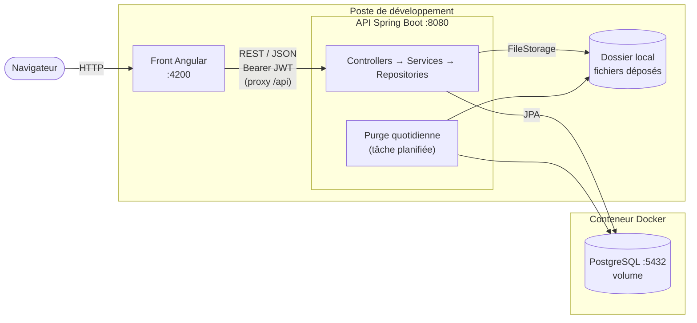
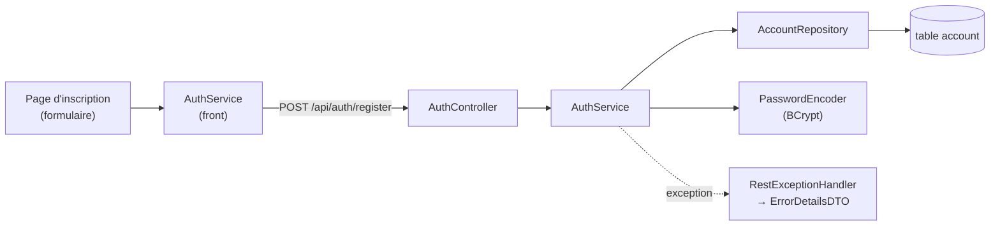
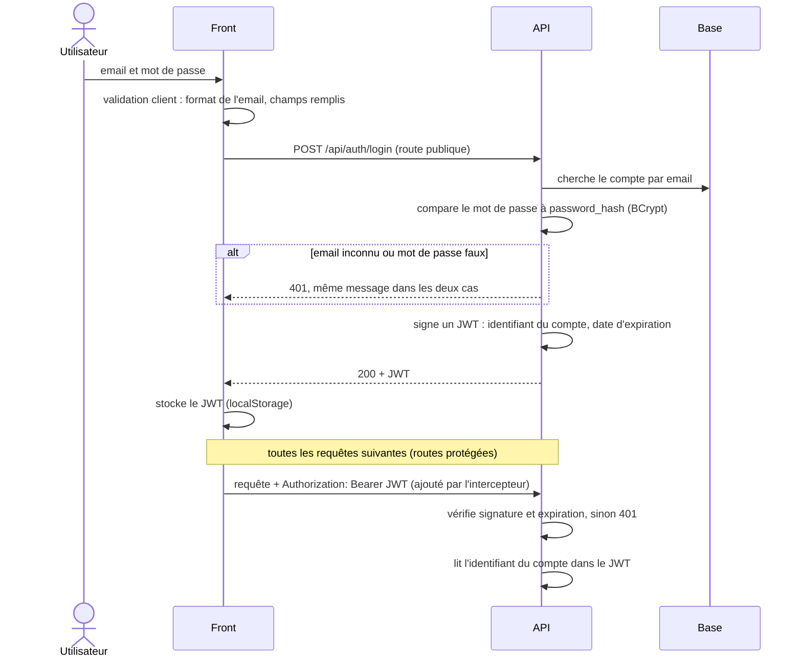
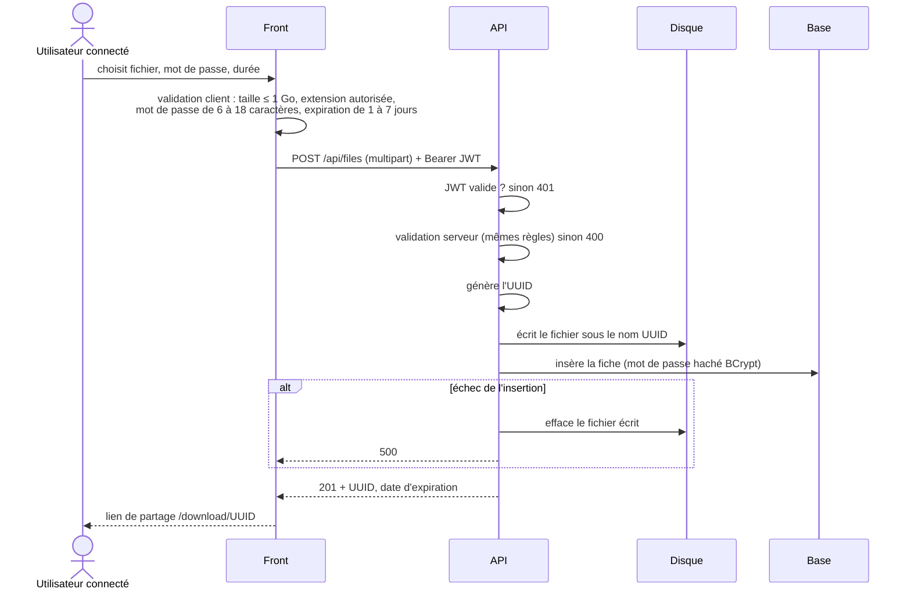
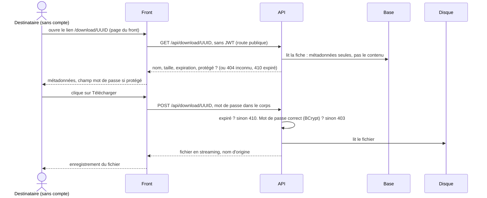
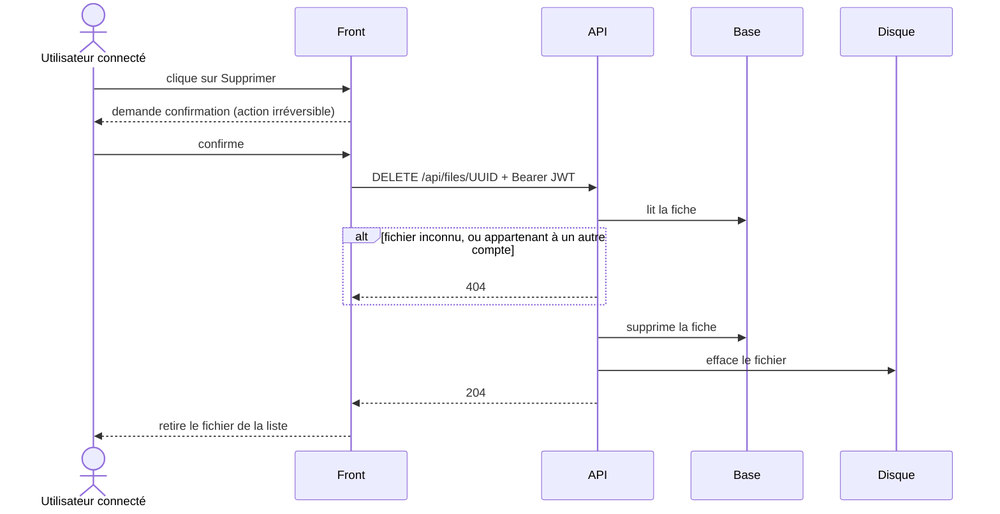

# Architecture technique

Comment les briques s'emboîtent et comment les données circulent. Le choix de
chaque technologie est justifié dans [`choix-techno.md`](choix-techno.md).

## Vue d'ensemble



| Brique | Rôle | Technologie | Où elle tourne |
|---|---|---|---|
| Front | écrans, validation client, stockage du JWT | Angular | `ng serve`, port 4200 |
| API | règles métier, validation serveur, sécurité | Spring Boot | poste, port 8080 |
| Base de données | comptes et fiches des fichiers | PostgreSQL + Flyway | conteneur lancé par Spring, données sur un volume Docker |
| Stockage des fichiers | contenu des fichiers, nommés par leur UUID | disque local | dossier configurable du poste |
| Authentification | prouver l'identité à chaque requête | JWT signé (HS256), BCrypt | émis et vérifié par l'API |

**Le contenu d'un fichier ne passe jamais par la base** : PostgreSQL garde la fiche
(nom, taille, dates, empreinte du mot de passe), le disque garde les octets.

## En développement : proxy plutôt que CORS

Le front (`localhost:4200`) et l'API (`localhost:8080`) n'ont pas le même port, donc
pas la même **origine** pour le navigateur. Par sécurité, il bloque les appels d'une
origine vers une autre, sauf si le serveur les autorise explicitement (en-têtes
**CORS**).

Le serveur de dev Angular sert de **proxy** (`proxy.conf.json`) : le navigateur
appelle `localhost:4200/api/…`, et Angular relaie la requête à `localhost:8080`. Le
navigateur ne voit qu'une seule origine : il n'y a pas de CORS à gérer.

Pourquoi pas une configuration CORS dans Spring :
- elle n'existerait **que pour le dev**. En production, front et API sont servis
  derrière un même reverse proxy, sous le même domaine : le proxy de dev reproduit
  déjà ce schéma ;
- CORS ne protège pas l'API, il protège l'utilisateur : le navigateur empêche un
  autre site de lire les réponses de l'API. Configurer CORS, c'est **assouplir**
  cette protection, et une règle trop large la lève pour tout le monde.

## Sécurité : rôle de chaque couche

| Couche | Garantit | Où |
|---|---|---|
| Infrastructure (reverse proxy, en production) | HTTPS · une origine unique, qui rend CORS superflu | hors périmètre du prototype |
| Application (Spring) | authentification JWT · mots de passe hachés (BCrypt) · droits sur les fichiers · validation | ce dépôt, en dev comme en prod |

Les deux se complètent : le proxy ne remplace aucun contrôle de l'application, qui
reste seule à protéger l'API contre un appel direct (`curl`, Postman).

### Configuration de Spring Security

`SpringSecurityConfig` remplace le comportement par défaut de Spring Security, qui
verrouille toutes les routes derrière un formulaire de connexion.

| Réglage | Raison |
|---|---|
| `PasswordEncoder` = BCrypt | Le service ne connaît que l'interface : changer d'algorithme ne touche que la configuration. BCrypt **sale** chaque hash (sel aléatoire stocké dans le hash, `$2a$10$<sel><empreinte>`) : deux mots de passe identiques donnent deux hash différents. |
| CSRF désactivé | Une attaque CSRF exploite les cookies que le navigateur envoie seul. Le JWT voyage dans un en-tête ajouté par le code du front : rien d'automatique à exploiter. |
| `STATELESS` | Aucune session côté serveur ; chaque requête apporte sa preuve (le JWT). |
| `/api/auth/**`, `/api/download/**` publics, le reste authentifié | Une règle par niveau d'accès (décision du 2026-10-03). |
| `oauth2ResourceServer` + `JwtDecoder` (HS256, même clé que l'encodeur) | Lit l'en-tête `Authorization: Bearer`, vérifie signature et expiration (tolérance de 60 s), puis remet le jeton au controller (`@AuthenticationPrincipal Jwt`), qui en lit l'identifiant du compte. Jeton absent, falsifié ou expiré : `401` à corps vide, avec l'en-tête standard `WWW-Authenticate: Bearer` (décision du 2026-10-12). |

**En-têtes ajoutés par défaut** à chaque réponse, conservés tels quels :

| En-tête | Protège contre |
|---|---|
| `X-Content-Type-Options: nosniff` | le navigateur qui « devine » le type d'un contenu : un fichier déposé servi comme texte ne peut pas être exécuté comme HTML ou JavaScript. Utile pour le téléchargement (US02). |
| `X-Frame-Options: DENY` | l'affichage de l'appli dans une `iframe` d'un autre site (*clickjacking* : faire cliquer l'utilisateur à son insu) |
| `Cache-Control: no-cache, no-store…` | la conservation de réponses sensibles dans le cache du navigateur ou d'un proxy |
| `Strict-Transport-Security` | le retour en HTTP non chiffré ; envoyé seulement en HTTPS, donc absent en dev |

## Validation en trois niveaux

Chaque règle (spécifications, [contrat d'interface](contrat-interface.md)) est
contrôlée à plusieurs niveaux, chacun pour une raison différente.

| Niveau | Rôle | Exemples |
|---|---|---|
| Front (formulaire) | **confort** : erreur immédiate, sans appel réseau | format de l'email, 8 caractères minimum, mots de passe identiques · taille ≤ 1 Go, extension autorisée |
| Back (`@Valid` sur le DTO, services) | **sécurité** : seule barrière fiable, l'API pouvant être appelée sans le front | mêmes règles, sauf la confirmation du mot de passe (propre au formulaire) |
| Base (contraintes SQL) | **garantie finale**, même en cas d'accès concurrent ou d'erreur de code | email unique · champs obligatoires · `expires_at > uploaded_at` |

Le niveau front est contournable (`curl`) ; le niveau base ne donne qu'une erreur
technique. C'est le back qui transforme chaque refus en réponse claire (`400`, `409`).

**Exemple : l'email du compte (US03, US04)**

| Où | Traitement | Pourquoi là |
|---|---|---|
| Front | retire les espaces, vérifie le format | confort : un email collé avec un espace en trop n'est pas bloqué |
| Back, DTO | vérifie le format (`@Email` : `400` si espaces ou format faux) | sécurité : l'API peut être appelée sans le front |
| Back, service | met en minuscules (`normalizeEmail`) | la forme de référence est fixée à un seul endroit, le serveur, pour tous les clients |
| Base | unicité (`uk_account_email`) | garantie finale |

## Découpage interne

### Back — par couche

| Package | Contient | Rôle |
|---|---|---|
| `controller/` | `AuthController`, `FileController` | reçoit la requête HTTP, appelle le service, renvoie la réponse et son code (201 créé, 404 introuvable…) |
| `service/` | `AuthService`, `FileService`, `JwtService`, `FilePurgeService` | règles métier et validation serveur |
| `repository/` | `AccountRepository`, `SharedFileRepository` | lecture et écriture en base (Spring Data JPA) : le CRUD est hérité de `JpaRepository` ; une requête de plus se déclare par le nom de la méthode (`findByEmail`), Spring écrit le SQL |
| `model/` | `Account`, `SharedFile` | entités JPA, le reflet des tables ; jamais renvoyées au client. `SharedFile` porte l'id de son propriétaire (`accountId`), sans relation JPA vers `Account` |
| `dto/` | objets d'entrée et de sortie, suffixés `DTO` (`RegisterRequestDTO`) ; l'énumération `FileStatus` | la forme exacte des données échangées avec le front. `FileStatus` est le type du champ `status`, jamais envoyé seul : il fait partie du contrat, d'où ce package, mais n'est pas un DTO, d'où l'absence de suffixe |
| `mapper/` | `FileMapper`, écrit à la main | convertit une entité en DTO. Ajoute des champs **calculés**, absents des tables : le statut, déduit de `expires_at` comparée à l'heure actuelle ; « protégé » (oui / non), qui fait afficher le cadenas et le champ mot de passe, déduit de `password_hash` sans jamais envoyer ce hash au front |
| `storage/` | `FileStorage`, `LocalFileStorage` | écrit, lit et efface un fichier sur le disque, sans rien décider : ce sont les services qui choisissent quoi effacer (`FileService` pour la suppression US06, `FilePurgeService` pour la purge) |
| `configuration/` | `SpringSecurityConfig` | routes publiques ou protégées ; fabrique les outils de sécurité (BCrypt, signature et vérification du JWT) |
| `exception/` | `RestExceptionHandler`, exceptions métier (`EmailAlreadyUsedException`…) | transforme toute erreur en une réponse au même format (`ErrorDetailsDTO`) |

Un controller ne parle qu'à un service. Un service parle aux repositories et à
`FileStorage`, sans savoir où les octets sont rangés.

#### Outils de sécurité : qui fait quoi

`SpringSecurityConfig` fabrique les outils (`@Bean`) ; les services les déclarent
dans leur constructeur ; Spring les leur remet au démarrage (**injection de
dépendances**). Exemple avec le JWT :

- **le service** sait **quoi** faire : `JwtService` choisit le contenu du jeton (`sub`, `exp`) ;
- **l'outil** sait **comment** le faire : `JwtEncoder` signe en HS256 avec la clé ;
- **Spring** se contente de **les mettre en relation** au démarrage.

```
démarrage :  SpringSecurityConfig ──fabrique──► JwtEncoder ──Spring le remet──► JwtService
connexion :  JwtService choisit le contenu ──appelle──► jwtEncoder.encode() ──► jeton signé
```

Même partage pour le mot de passe : `AuthService` décide **quand** hacher,
`PasswordEncoder` sait **comment** (BCrypt). Changer d'algorithme ne touche que la
configuration ; un test peut passer ses propres outils au constructeur, sans Spring.

#### Stockage des fichiers : qui fait quoi

Même partage pour le disque : le service sait **quoi** ranger ou effacer, le stockage
sait **comment**, la configuration dit **où**.

| Acteur | Sait | Ignore |
|---|---|---|
| `FileService`, `FilePurgeService` | quoi : « range ce contenu sous cet UUID », « efface ce fichier » | où et comment c'est rangé |
| `FileStorage` (interface) | le contrat : `store(id, contenu)`, `delete(id)` | — |
| `LocalFileStorage` | comment : un fichier par UUID dans un dossier, copié morceau par morceau | pourquoi on lui demande d'écrire ou d'effacer |
| `application.properties` | où : `datashare.storage.directory` (`STORAGE_DIRECTORY`, défaut `back/uploads`) | — |

Sur le disque, **l'UUID est le nom du fichier** : ranger demande l'UUID *et* le
contenu, effacer demande l'UUID seul (comme un numéro de casier). Le contenu arrive en
`InputStream`, pas en `MultipartFile` : le stockage ignore HTTP, la purge s'en sert sans
requête.

Une interface pour une seule implémentation se justifie ici deux fois : le stockage
local est un choix provisoire (décision du 2026-09-30), et les tests de `FileService`
remplacent le stockage par un mock, sans toucher au disque.

#### Conversion entité → DTO : `FileMapper`

Le service appelle le mapper sur l'entité lue ou écrite, puis renvoie le DTO au
controller. Le mapper se place entre `model/` et `dto/`, pas entre le controller et
le service :

```
FileController ──► FileService ──► SharedFileRepository ──► SharedFile (entité)
                        │
                        └──► FileMapper.toResponse(entité) ──► FileResponseDTO ──► controller ──► JSON
```

```
SharedFile                               FileResponseDTO
  id, originalName, sizeBytes,   ──copiés──►  mêmes champs
  uploadedAt, expiresAt
  expiresAt + heure actuelle     ──calcul──►  status (ACTIVE · EXPIRING_SOON · EXPIRED)
  passwordHash                   ──calcul──►  passwordProtected (oui / non)
  accountId                      ──ignoré
```

| Rôle | Pourquoi |
|---|---|
| **filtre de sortie** | le DTO fixe la forme de la réponse ; le mapper décide comment chaque champ est rempli. Le hash devient un booléen, `accountId` ne sort pas. Une colonne ajoutée à l'entité ne fuit pas tant qu'on ne la recopie pas ici. |
| **champs calculés** | le statut dépend de l'heure actuelle : calculé à chaque conversion, jamais stocké. Échéance atteinte → `EXPIRED`, moins de 24 h → `EXPIRING_SOON`. |
| **écrit à la main** | deux conversions seulement (fiche du propriétaire, métadonnées publiques de l'US02), dont les champs utiles sont calculés : une méthode se lit et se teste mieux que des expressions dans des annotations MapStruct (décision du 2026-10-09). |

#### Parcours d'une requête : l'inscription (US03)



| Couche | Sait | Ignore |
|---|---|---|
| `AuthController` | HTTP : route, corps JSON, code `201` | les règles métier, la base |
| `AuthService` | les règles : email libre, mot de passe haché | HTTP, le SQL |
| `AccountRepository` | lire et écrire la table `account` | pourquoi on lui demande |
| `RestExceptionHandler` | traduire une exception en code et en `ErrorDetailsDTO` | où elle a été levée |

Les autres routes suivent le même chemin.

#### Ordre de construction d'une route

Chaque route est construite de bas en haut. Chaque pièce ne s'appuie que sur des pièces
déjà écrites : tout compile et se vérifie à chaque étape.

| # | Pièce | Traduit | Vérification |
|---|---|---|---|
| 1 | DTO | le contrat (`openapi.yaml`) | compilation |
| 2 | entité + repository | le schéma (`V1__init.sql`) | démarrage : Hibernate compare l'entité à la table |
| 3 | service | les règles métier, du DTO vers l'entité | tests unitaires |
| 4 | `RestExceptionHandler` | les exceptions du service en codes HTTP | via la pièce 5 |
| 5 | controller | le service, branché sur HTTP | test d'intégration, `curl` |

Les pièces 1 et 2 transcrivent des décisions prises à la conception ; le service les
relie. Le controller vient en dernier : il ne fait que brancher l'ensemble. Le front
suit, une fois la route vérifiée.

### Front — par écran

```
styles.css    design tokens + classes partagées : .card, .field, .button-primary, .callout-error, .callout-info…
app/
  app.*       coquille commune : <app-header>, <router-outlet>, footer
  core/       api.models, auth.service · plus tard auth.interceptor (ajoute le JWT), auth.guard
  features/   auth/ (register/, login/) · upload/ · download/ · my-files/
  shared/     composants réutilisés qui ont un comportement : header/ (« Se connecter » ou « Mon espace »)
```

Un élément **sans comportement** (bouton, champ, carte) est une classe CSS ; il ne
devient un composant Angular que s'il porte de la logique.

| Élément | Rôle | Équivalent back |
|---|---|---|
| `provideHttpClient()` (`app.config.ts`) | rend `HttpClient` injectable dans toute l'appli ; sans lui, erreur `NullInjectorError` au démarrage | — |
| `core/api.models.ts` | interfaces TypeScript qui reprennent les schémas d'`openapi.yaml`. Effacées à la compilation : elles aident l'éditeur, mais **ne vérifient rien** à l'exécution | les DTO, sans `@Valid` |
| `core/auth.service.ts` | `@Injectable({ providedIn: 'root' })` : une instance unique, créée par Angular à la première demande. Décrit l'appel HTTP et renvoie l'`Observable` de `HttpClient`, sans traiter les erreurs | un `@Service` |
| page (`features/`) | s'abonne (`subscribe`) : déclenche la requête, puis choisit quoi afficher (succès, message d'erreur) | — |

Le contrat est la référence commune : le DTO Java et l'interface TypeScript en
découlent tous les deux, aucun ne copie l'autre.

**Le service décrit l'appel ; la page le déclenche et décide quoi faire du
résultat.** Un `Observable` ne part qu'à l'abonnement : sans `subscribe`, aucune
requête n'est envoyée.

#### État de connexion (US04)

`AuthService` est le seul à connaître le jeton. Les pages et le header ne voient que
`isLoggedIn`.

```
login() ──200──► tap : jeton dans localStorage + signal token ──► isLoggedIn (computed) ──► header : « Mon espace »
        ──401──► tap sauté, rien n'est enregistré ──────────────────────────────────────► page : message d'erreur
```

| Support | Survit au rechargement | Prévient l'affichage quand il change |
|---|---|---|
| `localStorage` | oui | non |
| signal `token` | non | oui : le header se met à jour sans rechargement |

Le signal démarre avec la valeur de `localStorage` ; `login()` met à jour les deux.
« Connecté » signifie « un jeton est présent » : sa validité reste jugée par l'API
(décision du 2026-10-09).

## Flux principaux

Les routes ci-dessous sont celles du [contrat d'interface](contrat-interface.md).

### Connexion (US03, US04)



L'identité vient **toujours du JWT**, jamais d'un paramètre : l'historique (US05)
et la suppression (US06) savent ainsi à qui ils répondent, sans qu'on puisse se faire
passer pour un autre compte. Un message identique pour « email inconnu » et « mot de
passe faux » évite de révéler quels emails sont inscrits.

#### Le JWT et sa clé de signature

Un JWT a trois parties : `en-tête.contenu.signature`. Le contenu
(`{"sub": "42", "exp": …}`) est **encodé, pas chiffré** : n'importe qui peut le lire,
et l'utilisateur peut le modifier dans son navigateur (`"42"` → `"1"`).

La **clé de signature** (`JWT_SECRET`) sert à **authentifier le jeton comme émis
par notre back** : elle garantit son **origine** et son **intégrité** (personne ne l'a
modifié).

| Moment | Ce que fait Spring avec la clé |
|---|---|
| Connexion (US04) | `signature = HMAC-SHA256(contenu, clé)`, jointe au jeton |
| Chaque requête protégée | recalcule la signature du contenu reçu et la compare : différente → `401` ; identique → vérifie encore `exp` |

Le système complet : une clé, deux outils. Côté requête, le jeton n'est pas seulement
**décodé** (tout le monde peut lire du base64) mais **vérifié** : signature, puis `exp`.

```
                    JWT_SECRET (.env)
                         │
                   signingKey() ── clé HMAC-SHA256          (SpringSecurityConfig)
                    ┌────┴────┐
               JwtEncoder   JwtDecoder
                    │            │
connexion (US04) :  signe        │
  JwtService : sub = id du compte, exp = +1 h
                                 │
requête protégée : le filtre oauth2ResourceServer lit « Authorization: Bearer <jeton> »,
                   JwtDecoder vérifie la signature puis exp (tolérance de 60 s)
                     ├─ refusé ──► 401, corps vide, en-tête WWW-Authenticate
                     └─ accepté ──► Jwt remis au controller (@AuthenticationPrincipal) ──► id du compte
```

**Bearer** (« porteur ») : celui qui présente le jeton est authentifié, comme avec un
billet de concert. Le standard (RFC 6750) le place dans l'en-tête `Authorization` :

| Où placer le jeton | Problème |
|---|---|
| dans l'URL (`?token=…`) | finit dans les logs, l'historique du navigateur, l'en-tête `Referer` |
| dans un cookie | envoyé **automatiquement** par le navigateur, même quand un autre site déclenche la requête : attaque CSRF |
| **en-tête `Authorization`** | envoyé seulement par notre code (intercepteur du front) : pas de CSRF, d'où CSRF désactivé ; absent des URL |

Revers : quiconque vole le jeton peut s'en servir. Parades : HTTPS en production, durée
d'une heure, et la limite du stockage en `localStorage` notée dans `SECURITY.md`.

Modifier le contenu oblige à recalculer la signature, ce qui demande la clé. Celui qui
la détient peut donc se faire passer pour **n'importe quel compte** : elle reste sur le
serveur (`.env`, jamais versionné), et l'API refuse de démarrer sans elle. Le front ne
manipule que des jetons, jamais la clé.

Le reverse proxy et TLS ne remplacent pas ce contrôle : un jeton forgé voyage en HTTPS
comme un vrai, et seul le détenteur de la clé peut les distinguer.

HS256 est **symétrique** : la même clé signe et vérifie, ce qui convient à un back qui
fait les deux. Un service tiers qui devrait seulement vérifier les jetons demanderait
une paire de clés (RS256).

L'inscription (US03) suit le même chemin sans émettre de JWT : email unique vérifié,
mot de passe haché, réponse 201 ; l'utilisateur se connecte ensuite.

### Upload (US01)



#### Format de la requête : `multipart/form-data`

Le corps est découpé en **parties** séparées par une frontière (*boundary*) ; chacune a
un nom et porte du texte ou des octets bruts. C'est ce qu'envoie un formulaire HTML avec
un champ fichier, et ce que construit `FormData` côté Angular.

```
POST /api/files
Authorization: Bearer eyJhbGci…
Content-Type: multipart/form-data; boundary=----XyZ

------XyZ
Content-Disposition: form-data; name="file"; filename="vacances.mp4"
Content-Type: video/mp4

<octets bruts du fichier>
------XyZ
Content-Disposition: form-data; name="password"

s3cret
------XyZ
Content-Disposition: form-data; name="expirationDays"

3
------XyZ--
```

**Écarté : JSON**, qui ne transporte que du texte : le fichier passerait en base64
(+33 %, 1 Go deviendrait 1,33 Go) et le corps se lirait d'un bloc.

| Étape | Qui |
|---|---|
| découper les parties, écrire le fichier dans un dossier temporaire, refuser au-delà de 1 Go (`413`) | Tomcat et Spring (`application.properties`) |
| emballer la partie `file` dans un `MultipartFile` | Spring |
| remplir `UploadRequestDTO` **par nom de partie** | `@ModelAttribute` (et non `@RequestBody`, qui lit un seul corps JSON) |
| refuser un autre format (`415`) | `consumes = MULTIPART_FORM_DATA_VALUE` |

#### Trajet de la requête dans le back

```
POST /api/files  (multipart + Authorization: Bearer <jeton>)
  │
  ├─ filtre JWT ── jeton absent, falsifié, expiré ? ──► 401 (corps vide)
  │
  ├─ Spring : fichier de plus de 1 Go ? ──► RestExceptionHandler ──► 413
  ▼
FileController ── @Valid sur UploadRequestDTO : mot de passe, durée, fichier absent ? ──► 400
  │   lit l'id du compte dans le jeton vérifié
  ▼
FileService ── nom ou extension invalide ? ──► InvalidFileException ──► RestExceptionHandler ──► 400
  ▼
201 + FileResponseDTO
```

Dans le back, `FileService.upload` enchaîne :

```
upload(requête, accountId)            ← accountId lu dans le JWT par le controller
 │
 ├─ 1. contrôle du nom : vide ou > 255 caractères ? extension interdite ?  ──► InvalidFileException → 400 (rien n'est écrit)
 ├─ 2. prépare la fiche : UUID tiré, propriétaire, nom, taille,
 │                        uploadedAt = maintenant, expiresAt = maintenant + durée (7 j par défaut),
 │                        hash du mot de passe s'il y en a un
 ├─ 3. disque : fileStorage.store(UUID, contenu)
 ├─ 4. base   : sharedFileRepository.save(fiche)
 │              └─ échec ? ──► fileStorage.delete(UUID), puis l'erreur d'origine remonte (500)
 └─ 5. fileMapper.toResponse(fiche) ──► FileResponseDTO (201)
```

Extensions refusées : exécutables Windows (`exe`, `com`, `msi`), scripts (`bat`, `cmd`,
`ps1`, `vbs`, `sh`) et archives Java exécutables (`jar`). Seule la dernière extension
compte, casse ignorée : `facture.pdf.EXE` est refusé, `archive.exe.zip` accepté.

Le fichier est écrit **en streaming** sur le disque, jamais chargé en entier en mémoire.
Spring refuse par défaut tout envoi de plus de 1 Mo : ce plafond est porté à
**1 Go**, la taille maximale autorisée par les spécifications.

### Téléchargement (US02)

Le destinataire **n'a pas de compte** : posséder le lien suffit (spec US02). C'est
l'expéditeur qui le lui transmet, par ses propres moyens (mail, messagerie), après
l'avoir copié sur l'écran « lien généré » ; l'application n'envoie aucun email.



Mot de passe en `POST`, **jamais dans l'URL** : une URL finit dans les logs du
serveur et l'historique du navigateur.

### Suppression (US06)



Le fichier d'un autre compte reçoit la même réponse qu'un fichier inexistant : l'API
ne confirme pas son existence.

### Expiration et purge (US01, US10 partielle)

Le statut n'est **jamais stocké** : `FileMapper` le calcule à chaque conversion en
fiche (`FileResponseDTO`), en comparant `expires_at` à l'heure courante. Il vaut
`EXPIRING_SOON` quand il reste moins de 24 h.

| Quand | Qui | Effet |
|---|---|---|
| à chaque téléchargement | `FileService` | refus si `expires_at` est dépassée |
| à chaque fiche renvoyée (upload, historique) | `FileMapper` | statut `ACTIVE` · `EXPIRING_SOON` · `EXPIRED` |
| chaque nuit | `FilePurgeService` (`@Scheduled`) | efface du disque les fichiers expirés, **garde la fiche** |

La purge efface « si le fichier existe encore » : la relancer ne casse rien.

## Cohérence entre disque et base

Une transaction PostgreSQL est **atomique** (le A d'ACID) : tout ou rien, mais
seulement **dans la base**. Le système de fichiers n'est pas transactionnel et
n'entre pas dans cette transaction : une opération peut réussir sur le disque et
échouer en base, ou l'inverse. On compense donc à la main. La règle : **mieux vaut un fichier orphelin sur le
disque qu'une fiche qui pointe vers un fichier absent**.

| Opération | Qui efface | Ordre | Si la 2ᵉ étape échoue |
|---|---|---|---|
| Envoi (US01) | `FileService`, en compensation | disque, puis base | le fichier écrit est effacé |
| Suppression (US06) | `FileService` | base, puis disque | fichier orphelin, journalisé |
| Purge (US10 partielle) | `FilePurgeService` | disque seul, la fiche est gardée | réessayé la nuit suivante |

`FileStorage` exécute, il ne décide jamais. Effacer un fichier déjà absent n'est pas
une erreur (`deleteIfExists`) : la purge peut repasser après une suppression, ou tourner
deux fois, sans rien casser.
