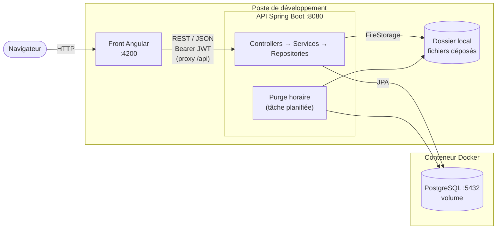
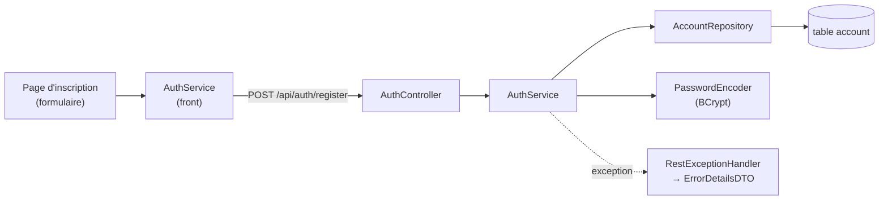

# Architecture technique

## L'essentiel

| | |
|---|---|
| **Briques** | front Angular → API Spring Boot → PostgreSQL (fiches) et disque local (contenu des fichiers) |
| **Couches du back** | controller (HTTP) → service (règles métier) → repository (base) ; des DTO entre l'API et le front, jamais d'entité exposée |
| **Sécurité** | JWT vérifié à chaque requête protégée ; identité lue dans le jeton ; validation au front, au back **et** en base |
| **Stockage** | derrière l'interface `FileStorage` : passer à un stockage objet ne touche pas aux services |
| **Disque et base** | pas de transaction commune : ordre d'écriture fixé et compensation ([Cohérence](#cohérence-entre-disque-et-base)) |
| **Flux** | un par user story, détaillés dans [`flux.md`](flux.md) |

Comment les briques s'emboîtent ; le choix de chaque technologie est justifié dans
[`choix-techno.md`](choix-techno.md). Les passages repliés détaillent le code, pour
qui reprend le projet.

## Vue d'ensemble



| Brique | Rôle | Technologie | Où elle tourne |
|---|---|---|---|
| Front | écrans, validation client, stockage du JWT | Angular | `ng serve`, port 4200 |
| API | règles métier, validation serveur, sécurité | Spring Boot | poste, port 8080 |
| Base de données | comptes et fiches des fichiers | PostgreSQL + Flyway | conteneur lancé par Spring, données sur un volume Docker |
| Stockage des fichiers | contenu des fichiers, nommés par leur UUID | disque local | dossier configurable du poste |
| Authentification | prouver l'identité à chaque requête | JWT signé (HS256), BCrypt | émis et vérifié par l'API |

**Le contenu d'un fichier ne passe jamais par la base** : PostgreSQL garde la fiche
(nom, taille, dates, empreinte du mot de passe), le disque garde les octets.

## En développement : proxy plutôt que CORS

Le front (`localhost:4200`) et l'API (`localhost:8080`) n'ont pas le même port, donc
pas la même **origine** pour le navigateur. Par sécurité, il bloque les appels d'une
origine vers une autre, sauf si le serveur les autorise explicitement (en-têtes
**CORS**).

Le serveur de dev Angular sert de **proxy** (`proxy.conf.json`) : le navigateur
appelle `localhost:4200/api/…`, et Angular relaie la requête à `localhost:8080`. Le
navigateur ne voit qu'une seule origine : il n'y a pas de CORS à gérer.

Pourquoi pas une configuration CORS dans Spring :
- elle n'existerait **que pour le dev**. En production, front et API sont servis
  derrière un même reverse proxy, sous le même domaine : le proxy de dev reproduit
  déjà ce schéma ;
- CORS ne protège pas l'API, il protège l'utilisateur : le navigateur empêche un
  autre site de lire les réponses de l'API. Configurer CORS, c'est **assouplir**
  cette protection, et une règle trop large la lève pour tout le monde.

## Sécurité : rôle de chaque couche

| Couche | Garantit | Où |
|---|---|---|
| Infrastructure (reverse proxy, en production) | HTTPS · une origine unique, qui rend CORS superflu | hors périmètre du prototype |
| Application (Spring) | authentification JWT · mots de passe hachés (BCrypt) · droits sur les fichiers · validation | ce dépôt, en dev comme en prod |

Les deux se complètent : le proxy ne remplace aucun contrôle de l'application, qui
reste seule à protéger l'API contre un appel direct (`curl`, Postman).

### Configuration de Spring Security

`SpringSecurityConfig` remplace le comportement par défaut de Spring Security, qui
verrouille toutes les routes derrière un formulaire de connexion.

| Réglage | Raison |
|---|---|
| `PasswordEncoder` = BCrypt | Le service ne connaît que l'interface : changer d'algorithme ne touche que la configuration. BCrypt **sale** chaque hash (sel aléatoire stocké dans le hash, `$2a$10$<sel><empreinte>`) : deux mots de passe identiques donnent deux hash différents. |
| CSRF désactivé | Une attaque CSRF exploite les cookies que le navigateur envoie seul. Le JWT voyage dans un en-tête ajouté par le code du front : rien d'automatique à exploiter. |
| `STATELESS` | Aucune session côté serveur ; chaque requête apporte sa preuve (le JWT). |
| `/api/auth/**`, `/api/download/**` publics, le reste authentifié | Une règle par niveau d'accès (décision du 2026-10-03). |
| Swagger UI, description de l'API et `/actuator/health` publics | Outils techniques, sans donnée : le Swagger UI s'ouvre sans jeton, une sonde de santé est appelée par des machines qui n'en ont pas (décisions du 2026-10-19). |
| `oauth2ResourceServer` + `JwtDecoder` (HS256, même clé que l'encodeur) | Lit l'en-tête `Authorization: Bearer`, vérifie signature et expiration (tolérance de 60 s), puis remet le jeton au controller (`@AuthenticationPrincipal Jwt`), qui en lit l'identifiant du compte. Jeton absent, falsifié ou expiré : `401` à corps vide, avec l'en-tête standard `WWW-Authenticate: Bearer` (décision du 2026-10-12). |

**En-têtes ajoutés par défaut** à chaque réponse, conservés tels quels :

| En-tête | Protège contre |
|---|---|
| `X-Content-Type-Options: nosniff` | le navigateur qui « devine » le type d'un contenu : un fichier déposé servi comme texte ne peut pas être exécuté comme HTML ou JavaScript. Utile pour le téléchargement (US02). |
| `X-Frame-Options: DENY` | l'affichage de l'appli dans une `iframe` d'un autre site (*clickjacking* : faire cliquer l'utilisateur à son insu) |
| `Cache-Control: no-cache, no-store…` | la conservation de réponses sensibles dans le cache du navigateur ou d'un proxy |
| `Strict-Transport-Security` | le retour en HTTP non chiffré ; envoyé seulement en HTTPS, donc absent en dev |

## Validation en trois niveaux

Chaque règle (spécifications, [contrat d'interface](contrat-interface.md)) est
contrôlée à plusieurs niveaux, chacun pour une raison différente.

| Niveau | Rôle | Exemples |
|---|---|---|
| Front (formulaire) | **confort** : erreur immédiate, sans appel réseau | format de l'email, 8 caractères minimum, mots de passe identiques · taille ≤ 1 Go, extension autorisée |
| Back (`@Valid` sur le DTO, services) | **sécurité** : seule barrière fiable, l'API pouvant être appelée sans le front | mêmes règles, sauf la confirmation du mot de passe (propre au formulaire) |
| Base (contraintes SQL) | **garantie finale**, même en cas d'accès concurrent ou d'erreur de code | email unique · champs obligatoires · `expires_at > uploaded_at` |

Le niveau front est contournable (`curl`) ; le niveau base ne donne qu'une erreur
technique. C'est le back qui transforme chaque refus en réponse claire (`400`, `409`).

<details>
<summary>Exemple : l'email du compte (US03, US04)</summary>

| Où | Traitement | Pourquoi là |
|---|---|---|
| Front | retire les espaces, vérifie le format | confort : un email collé avec un espace en trop n'est pas bloqué |
| Back, DTO | vérifie le format (`@Email` : `400` si espaces, format faux ou domaine sans point) | sécurité : l'API peut être appelée sans le front |
| Back, service | met en minuscules (`normalizeEmail`) | la forme de référence est fixée à un seul endroit, le serveur, pour tous les clients |
| Base | unicité (`uk_account_email`) | garantie finale |

</details>

## Découpage interne

### Back — par couche

| Package | Contient | Rôle |
|---|---|---|
| `controller/` | `AuthController`, `FileController` (propriétaire, JWT), `DownloadController` (destinataire, public) | reçoit la requête HTTP, appelle le service, renvoie la réponse et son code (201 créé, 404 introuvable…). Un controller par préfixe de route, donc par niveau d'accès |
| `service/` | `AuthService`, `FileService`, `JwtService`, `FilePurgeService` | règles métier et validation serveur |
| `repository/` | `AccountRepository`, `SharedFileRepository` | lecture et écriture en base (Spring Data JPA) : le CRUD est hérité de `JpaRepository` ; une requête de plus se déclare par le nom de la méthode (`findByEmail`), Spring écrit le SQL |
| `model/` | `Account`, `SharedFile` | entités JPA, le reflet des tables ; jamais renvoyées au client. `SharedFile` porte l'id de son propriétaire (`accountId`), sans relation JPA vers `Account` |
| `dto/` | objets d'entrée et de sortie, suffixés `DTO` (`RegisterRequestDTO`) ; l'énumération `FileStatus` | la forme exacte des données échangées avec le front. `FileStatus` est le type du champ `status`, jamais envoyé seul : il fait partie du contrat, d'où ce package, mais n'est pas un DTO, d'où l'absence de suffixe. Seul `FileContentDTO` (nom, taille, flux du fichier) ne sort jamais en JSON : il passe du service au controller, qui en fait la réponse binaire |
| `mapper/` | `FileMapper`, écrit à la main | convertit une entité en DTO. Ajoute des champs **calculés**, absents des tables : le statut, déduit de `expires_at` comparée à l'heure actuelle ; « protégé » (oui / non), qui fait afficher le cadenas et le champ mot de passe, déduit de `password_hash` sans jamais envoyer ce hash au front |
| `storage/` | `FileStorage`, `LocalFileStorage` | écrit, lit et efface un fichier sur le disque, sans rien décider : ce sont les services qui choisissent quoi effacer (`FileService` pour la suppression US06, `FilePurgeService` pour la purge) |
| `configuration/` | `SpringSecurityConfig`, `OpenApiConfig` | routes publiques ou protégées ; fabrique les outils de sécurité (BCrypt, signature et vérification du JWT). `OpenApiConfig` nomme l'API et déclare le schéma JWT pour le Swagger UI |
| `exception/` | `RestExceptionHandler`, exceptions métier (`EmailAlreadyUsedException`…) | transforme toute erreur en une réponse au même format (`ErrorDetailsDTO`) |

Un controller ne parle qu'à un service. Un service parle aux repositories et à
`FileStorage`, sans savoir où les octets sont rangés.

<details>
<summary>Outils de sécurité : qui fait quoi</summary>

`SpringSecurityConfig` fabrique les outils (`@Bean`) ; les services les déclarent
dans leur constructeur ; Spring les leur remet au démarrage (**injection de
dépendances**). Exemple avec le JWT :

- **le service** sait **quoi** faire : `JwtService` choisit le contenu du jeton (`sub`, `exp`) ;
- **l'outil** sait **comment** le faire : `JwtEncoder` signe en HS256 avec la clé ;
- **Spring** se contente de **les mettre en relation** au démarrage.

```
démarrage :  SpringSecurityConfig ──fabrique──► JwtEncoder ──Spring le remet──► JwtService
connexion :  JwtService choisit le contenu ──appelle──► jwtEncoder.encode() ──► jeton signé
```

Même partage pour le mot de passe : `AuthService` décide **quand** hacher,
`PasswordEncoder` sait **comment** (BCrypt). Changer d'algorithme ne touche que la
configuration ; un test peut passer ses propres outils au constructeur, sans Spring.

</details>

<details>
<summary>Stockage des fichiers : qui fait quoi</summary>

Même partage pour le disque : le service sait **quoi** ranger ou effacer, le stockage
sait **comment**, la configuration dit **où**.

| Acteur | Sait | Ignore |
|---|---|---|
| `FileService`, `FilePurgeService` | quoi : « range ce contenu sous cet UUID », « efface ce fichier » | où et comment c'est rangé |
| `FileStorage` (interface) | le contrat : `store(id, contenu)`, `read(id)`, `delete(id)` | — |
| `LocalFileStorage` | comment : un fichier par UUID dans un dossier, copié morceau par morceau | pourquoi on lui demande d'écrire ou d'effacer |
| `application.properties` | où : `datashare.storage.directory` (`STORAGE_DIRECTORY`, défaut `back/uploads`) | — |

Sur le disque, **l'UUID est le nom du fichier** : ranger demande l'UUID *et* le
contenu, effacer demande l'UUID seul (comme un numéro de casier). Le contenu arrive en
`InputStream`, pas en `MultipartFile` : le stockage ignore HTTP, la purge s'en sert sans
requête.

Une interface pour une seule implémentation se justifie ici deux fois : le stockage
local est un choix provisoire (décision du 2026-09-30), et les tests de `FileService`
remplacent le stockage par un mock, sans toucher au disque.

</details>

<details>
<summary>Conversion entité → DTO : <code>FileMapper</code></summary>

Le service appelle le mapper sur l'entité lue ou écrite, puis renvoie le DTO au
controller. Le mapper se place entre `model/` et `dto/`, pas entre le controller et
le service :

```
FileController ──► FileService ──► SharedFileRepository ──► SharedFile (entité)
                        │
                        └──► FileMapper.toResponse(entité) ──► FileResponseDTO ──► controller ──► JSON
```

```
SharedFile                               FileResponseDTO
  id, originalName, sizeBytes,   ──copiés──►  mêmes champs
  uploadedAt, expiresAt
  expiresAt + heure actuelle     ──calcul──►  status (ACTIVE · EXPIRING_SOON · EXPIRED)
  passwordHash                   ──calcul──►  passwordProtected (oui / non)
  accountId                      ──ignoré
```

| Rôle | Pourquoi |
|---|---|
| **filtre de sortie** | le DTO fixe la forme de la réponse ; le mapper décide comment chaque champ est rempli. Le hash devient un booléen, `accountId` ne sort pas. Une colonne ajoutée à l'entité ne fuit pas tant qu'on ne la recopie pas ici. |
| **champs calculés** | le statut dépend de l'heure actuelle : calculé à chaque conversion, jamais stocké. Échéance atteinte → `EXPIRED`, moins de 24 h → `EXPIRING_SOON`. |
| **écrit à la main** | deux conversions seulement (fiche du propriétaire, métadonnées publiques de l'US02), dont les champs utiles sont calculés : une méthode se lit et se teste mieux que des expressions dans des annotations MapStruct (décision du 2026-10-09). |

**Tous les DTO n'ont pas de mapper.** Un mapper n'existe que s'il y a une vraie
conversion d'entité à isoler et à tester. C'est la règle de ce projet, pas une règle
universelle : ailleurs, on convertit dans le service, dans une méthode du DTO
(`FileResponseDTO.from(entité)`) ou avec MapStruct.

| DTO | Construit par | Pourquoi pas de mapper |
|---|---|---|
| `FileResponseDTO`, `FileMetadataResponseDTO` | `FileMapper` | — : conversion depuis `SharedFile`, avec des champs calculés |
| `RegisterRequestDTO`, `LoginRequestDTO`, `UploadRequestDTO`, `DownloadRequestDTO` | Spring, depuis la requête | DTO **entrants** : le service lit leurs champs |
| `LoginResponseDTO` | `AuthService` | un seul champ, le jeton |
| `FileContentDTO` | `FileService` | usage interne, pas une conversion d'entité |
| `ErrorDetailsDTO` | `RestExceptionHandler` | construit depuis une exception |

Le sens inverse (DTO → entité, à l'upload) reste dans `FileService` : remplir une
`SharedFile` demande des décisions métier (tirer l'UUID, calculer l'expiration,
hacher le mot de passe), pas une simple copie.

</details>

<details>
<summary>D'où vient chaque donnée d'une requête</summary>

Chaque paramètre d'une méthode de controller vient d'un endroit précis de la requête
HTTP. Une méthode prend ce dont elle a besoin : DTO, identifiant, JWT, ou plusieurs.

| Source | Annotation | Ce qu'elle dit |
|---|---|---|
| corps de la requête | `@RequestBody` (JSON), `@ModelAttribute` (formulaire multipart) → **DTO** | les données envoyées |
| URL | `@PathVariable` | sur quel fichier on agit |
| en-tête `Authorization` | `@AuthenticationPrincipal Jwt` | **qui** appelle |

| Route | DTO | URL | JWT | Réponse |
|---|---|---|---|---|
| `register`, `login` | ✓ | | | rien / `LoginResponseDTO` |
| `upload` (US01) | ✓ `UploadRequestDTO` : fichier, mot de passe, durée | | ✓ propriétaire du fichier | `FileResponseDTO` |
| `listMyFiles` (US05) | | | ✓ dont on liste les fichiers | liste de `FileResponseDTO` |
| `delete` (US06) | | ✓ `id` | ✓ propriétaire vérifié | rien (`204`) |
| `getMetadata` (US02) | | ✓ `id` | | `FileMetadataResponseDTO` |
| `download` (US02) | ✓ `DownloadRequestDTO`, facultatif | ✓ `id` | | le fichier |

Le DTO décrit les données échangées ; le JWT identifie l'appelant. **Le compte n'est
jamais un champ de DTO ni un paramètre d'URL** : on ne peut ni envoyer un fichier au nom
d'un autre, ni lister ou supprimer les fichiers d'un autre. Les routes de
téléchargement, publiques, n'ont pas de JWT : le destinataire n'a pas de compte.

</details>

#### Parcours d'une requête : l'inscription (US03)



| Couche | Sait | Ignore |
|---|---|---|
| `AuthController` | HTTP : route, corps JSON, code `201` | les règles métier, la base |
| `AuthService` | les règles : email libre, mot de passe haché | HTTP, le SQL |
| `AccountRepository` | lire et écrire la table `account` | pourquoi on lui demande |
| `RestExceptionHandler` | traduire une exception en code et en `ErrorDetailsDTO` | où elle a été levée |

Les autres routes suivent le même chemin.

<details>
<summary>Ordre de construction d'une route</summary>

Chaque route est construite de bas en haut. Chaque pièce ne s'appuie que sur des pièces
déjà écrites : tout compile et se vérifie à chaque étape.

| # | Pièce | Traduit | Vérification |
|---|---|---|---|
| 1 | DTO | le contrat (`openapi.yaml`) | compilation |
| 2 | entité + repository | le schéma (`V1__init.sql`) | démarrage : Hibernate compare l'entité à la table |
| 3 | service | les règles métier, du DTO vers l'entité | tests unitaires |
| 4 | `RestExceptionHandler` | les exceptions du service en codes HTTP | via la pièce 5 |
| 5 | controller | le service, branché sur HTTP | test d'intégration, `curl` |

Les pièces 1 et 2 transcrivent des décisions prises à la conception ; le service les
relie. Le controller vient en dernier : il ne fait que brancher l'ensemble. Le front
suit, une fois la route vérifiée.

</details>

### Front — par écran

```
styles.css    design tokens + classes partagées : .card, .field, .button-primary, .button-dark, .callout-*, .file (icône, nom, taille)…
app/
  app.*       coquille commune : <app-header>, <router-outlet>, footer
  core/       api.models, auth.service, file.service (propriétaire), download.service (public), auth.interceptor (ajoute le JWT), auth.guard (réserve une page aux connectés)
  features/   auth/ (register/, login/) · upload/ · download/ · my-files/
  shared/     ce que plusieurs écrans réutilisent : header/ (« Se connecter », ou « Mon espace » + « Déconnexion ») · file-size.pipe (« 2,6 Mo ») · save-file (enregistre un fichier reçu) · expiry (« demain », « dans 3 jours »)
```

Un élément **sans comportement** (bouton, champ, carte) est une classe CSS ; il ne
devient un composant Angular que s'il porte de la logique.

| Élément | Rôle | Équivalent back |
|---|---|---|
| `provideHttpClient()` (`app.config.ts`) | rend `HttpClient` injectable dans toute l'appli ; sans lui, erreur `NullInjectorError` au démarrage | — |
| `core/api.models.ts` | interfaces TypeScript qui reprennent les schémas d'`openapi.yaml`. Effacées à la compilation : elles aident l'éditeur, mais **ne vérifient rien** à l'exécution | les DTO, sans `@Valid` |
| `core/auth.service.ts` | `@Injectable({ providedIn: 'root' })` : une instance unique, créée par Angular à la première demande. Décrit l'appel HTTP et renvoie l'`Observable` de `HttpClient`, sans traiter les erreurs | un `@Service` |
| page (`features/`) | s'abonne (`subscribe`) : déclenche la requête, puis choisit quoi afficher (succès, message d'erreur) | — |

Le contrat est la référence commune : le DTO Java et l'interface TypeScript en
découlent tous les deux, aucun ne copie l'autre.

**Le service décrit l'appel ; la page le déclenche et décide quoi faire du
résultat.** Un `Observable` ne part qu'à l'abonnement : sans `subscribe`, aucune
requête n'est envoyée.

<details>
<summary>État de connexion (US04)</summary>

`AuthService` est le seul à stocker le jeton. Les pages et le header ne voient que
`isLoggedIn` ; l'intercepteur le lit (`getToken()`) pour l'envoyer à l'API.

```
login() ──200──► tap : jeton dans localStorage + signal token ──► isLoggedIn (computed) ──► header : « Mon espace »
        ──401──► tap sauté, rien n'est enregistré ──────────────────────────────────────► page : message d'erreur
logout() ──────► jeton retiré de localStorage + signal à null ──► isLoggedIn faux ───────► header : « Se connecter »
```

`logout()` a deux appelants : le bouton « Déconnexion » du header (US05) et
l'intercepteur sur un `401`. Tous deux redirigent ensuite vers `/login` ; l'intercepteur
ajoute `?expired=true`, pour que la page dise pourquoi (décision du 2026-10-19). **Aucun appel
à l'API** : le JWT est sans état, le back n'a pas de session à fermer. Un jeton copié
reste donc valable jusqu'à son `exp` (1 h au plus, limite tracée dans `SECURITY.md`).

| Support | Survit au rechargement | Prévient l'affichage quand il change |
|---|---|---|
| `localStorage` | oui | non |
| signal `token` | non | oui : le header se met à jour sans rechargement |

Le signal démarre avec la valeur de `localStorage` ; `login()` et `logout()` mettent à
jour les deux. « Connecté » signifie « un jeton est présent » : sa validité reste jugée
par l'API (décision du 2026-10-09).

</details>

<details>
<summary>Intercepteur : le jeton ajouté à chaque appel (US01)</summary>

`auth.interceptor.ts` voit passer **toutes** les requêtes de `HttpClient` : aucun
service n'ajoute le jeton lui-même.

| Requête | Ce que fait l'intercepteur |
|---|---|
| `/api/auth/**`, `/api/download/**` (publiques) | rien : un jeton expiré envoyé là ferait répondre `401` par Spring, qui vérifie tout jeton reçu |
| toute autre route `/api` | ajoute `Authorization: Bearer <jeton>` s'il y en a un |
| réponse `401` d'une route protégée | `logout()`, puis redirection vers `/login?expired=true` (message « session expirée ») ; l'erreur continue jusqu'à la page |

Le `401` de `/api/auth/login` (identifiants refusés) n'est pas intercepté : c'est la page
de connexion qui l'affiche.

</details>

<details>
<summary>Guard : une page réservée aux connectés (US01)</summary>

`auth.guard.ts` est consulté par le routeur **avant** d'afficher une page qui le déclare
(`canActivate` dans `app.routes.ts`) : sans jeton, il renvoie vers `/login`. Il ne
protège rien côté serveur — l'API refuse de toute façon l'appel sans jeton valide —, il
évite seulement d'afficher un écran inutilisable. **Le guard décide de l'affichage,
l'API décide de l'accès.**

| Situation | Qui réagit |
|---|---|
| pas de jeton, ouverture de `/` | le guard, avant l'affichage |
| URL inconnue | la route de repli `**` redirige vers `/`, puis le guard s'applique (décision du 2026-10-19) |
| jeton expiré, ouverture de `/` | personne : le guard ne lit pas l'expiration (décision du 2026-10-09) ; l'intercepteur réagit au premier appel refusé (`401`) |

</details>

## Flux principaux

Le détail de chaque flux (diagrammes de séquence, format des requêtes, contrôles dans
l'ordre) est dans [`flux.md`](flux.md).

| Flux | En une phrase |
|---|---|
| [Connexion](flux.md#connexion-us03-us04) (US03, US04) | le mot de passe est vérifié par BCrypt ; l'API renvoie un JWT signé, valable 1 h, que le front joint à chaque appel protégé |
| [Upload](flux.md#upload-us01) (US01) | validation front, puis JWT et validation back ; le fichier est écrit sur le disque sous un UUID, puis sa fiche en base |
| [Téléchargement](flux.md#téléchargement-us02) (US02) | public : lien inconnu `404`, expiré `410`, mot de passe faux `403`, sinon le fichier en pièce jointe |
| [Historique](flux.md#historique-us05) (US05) | les fiches du compte du jeton, triées par la base, statut calculé à la volée |
| [Suppression](flux.md#suppression-us06) (US06) | fiche effacée, puis fichier ; le fichier d'un autre compte répond `404` |
| [Expiration et purge](flux.md#expiration-et-purge-us01-us10-partielle) (US10 partielle) | toutes les heures, les fichiers expirés sont effacés du disque ; leur fiche reste |

## Cohérence entre disque et base

Une transaction PostgreSQL est **atomique** (le A d'ACID) : tout ou rien, mais
seulement **dans la base**. Le système de fichiers n'est pas transactionnel et
n'entre pas dans cette transaction : une opération peut réussir sur le disque et
échouer en base, ou l'inverse. On compense donc à la main. La règle : **mieux vaut un fichier orphelin sur le
disque qu'une fiche qui pointe vers un fichier absent**.

| Opération | Qui efface | Ordre | Si la 2ᵉ étape échoue |
|---|---|---|---|
| Envoi (US01) | `FileService`, en compensation | disque, puis base | le fichier écrit est effacé |
| Suppression (US06) | `FileService` | base, puis disque | fichier orphelin, journalisé |
| Purge (US10 partielle) | `FilePurgeService` | disque seul, la fiche est gardée | retenté au passage suivant |

**Pourquoi la fiche avant le fichier, à la suppression.** Dans l'ordre inverse, un échec
en base laisserait une fiche sans fichier : visible dans l'historique, lien partagé
encore valide, et une erreur au téléchargement. Un orphelin, lui, est invisible pour
l'utilisateur ; seul le journal (`log.warn`, avec l'UUID) le signale. Pour que la fiche
soit vraiment effacée **avant** le disque, `FileService.delete` n'est pas
`@Transactional` : `repository.delete()` valide sa propre transaction aussitôt. Avec une
transaction englobante, la validation n'aurait lieu qu'après l'effacement du disque, et
pourrait encore échouer.

**Volume des orphelins.** Un orphelin ne naît que d'une panne du disque au moment précis
de l'effacement (droits, erreur d'entrée-sortie) : rare, et repéré dans le journal. La purge
ne les voit pas, elle part des fiches. Leur nettoyage est une perspective (« Purge des
orphelins »).

`FileStorage` exécute, il ne décide jamais. Effacer un fichier déjà absent n'est pas
une erreur (`deleteIfExists`) : la purge peut repasser après une suppression, ou tourner
deux fois, sans rien casser.

## Sonde de santé (Actuator)

**Actuator** (`spring-boot-starter-actuator`) ajoute des routes techniques sous
`/actuator/`, pour observer l'application en marche. Aucune ligne de code : la
dépendance suffit, Spring Boot la configure au démarrage.

`/actuator/health` répond à « l'API peut-elle servir maintenant ? ». À chaque appel,
Spring interroge des **indicateurs**, détectés d'après ce que contient l'application :

| Indicateur | Présent parce que | Vérifie |
|---|---|---|
| `db` | une `DataSource` existe | une requête de test sur PostgreSQL |
| `diskSpace` | toujours | l'espace libre du disque où l'API est lancée (`back/`) : celui des fichiers déposés, tant que `STORAGE_DIRECTORY` n'en désigne pas un autre |
| `ping` | toujours | rien : répond toujours `UP` |

Un seul indicateur `DOWN` donne `{"status":"DOWN"}` et un code `503` : le processus
tourne, mais ne peut plus servir.

- **Passive** : rien ne l'appelle tout seul. Aujourd'hui, la vérification du README et
  `HealthCheckTest` ; en production, un orchestrateur, un load balancer ou un outil de
  supervision, à intervalle régulier.
- **Exposition** : seule `health` est publiée en HTTP (défaut de Spring Boot), publique
  et sans détail. Les autres routes (`env` : la configuration, `heapdump` : la mémoire,
  clé JWT comprise) ne sont pas publiées, et resteraient protégées par Spring Security.
- **Sur Kubernetes** : Spring Boot ajoute `/actuator/health/liveness` (redémarrer le
  conteneur ?) et `/actuator/health/readiness` (lui envoyer du trafic ?). La règle
  actuelle n'ouvre que `/actuator/health` exactement : ces deux routes seraient à ouvrir.

## Journalisation

Certaines erreurs ne sont **pas renvoyées à l'utilisateur** : un orphelin laissé par la
suppression ne l'empêche pas d'obtenir son `204`. Sans trace écrite, ce problème serait
silencieux. Le journal est la seule façon de le voir.

| Pièce | Rôle |
|---|---|
| **SLF4J** | l'interface appelée par le code (`log.atInfo()...`) |
| **Logback** | l'implémentation qui écrit, fournie par Spring Boot (`spring-boot-starter-logging`) |
| **`@Slf4j`** (Lombok) | génère le champ `log` de la classe |
| **`application.properties`** | console en texte lisible ; fichier `logs/datashare.log` en JSON (format ECS, supporté nativement par Spring Boot) |
| **`RequestLoggingFilter`** (package `logging`) | une ligne par requête HTTP : méthode, chemin, statut, durée |
| **`FileService.logFileEvent`** | une ligne par upload, download, delete : identifiant, taille, propriétaire |
| **`FilePurgeService`** | une ligne par passage de la purge (nombre de fiches expirées) ; un avertissement par fichier qu'elle n'a pas pu effacer |

Ce qu'un log apporte, là où un `System.out.println` n'apporterait rien :

- un **niveau** (`WARN`) : filtrable, repérable parmi les messages courants ;
- l'**horodatage** et la **classe** émettrice ;
- l'**UUID** du fichier, qui est aussi son nom sur le disque : l'orphelin se retrouve
  et s'efface à la main ;
- la **cause** (trace de l'exception) : droits, disque plein, erreur matérielle ;
- une **destination décidée par la configuration**, pas par le code : console en
  développement, outil de collecte en production.

C'est aussi le déclencheur de la perspective « Purge des orphelins » : on l'automatise
quand les avertissements se répètent dans les logs.

**Logs structurés.** Chaque valeur est passée en clé-valeur (`addKeyValue("sizeBytes", …)`)
et devient un champ du JSON : on calcule dessus sans découper de phrases. Le message
reprend les valeurs pour la console, qui n'affiche pas les clés-valeurs.

**Le filtre passe en premier** (`@Order(HIGHEST_PRECEDENCE)`), avant Spring Security :
une requête refusée en `401` est mesurée elle aussi. Il écrit dans un `finally` : une
requête qui lève une exception est notée quand même.

**Les événements fichiers sont notés après le succès** : après l'enregistrement en base
pour l'upload, après l'ouverture du fichier pour le download. Un upload annulé ou un
fichier introuvable ne compte pas.

Usage, résultats et analyse : [`PERF.md`](../../PERF.md#logs-structurés-et-suivi-des-métriques) ;
ce qui n'est jamais journalisé : [`SECURITY.md`](../../SECURITY.md#journalisation).
