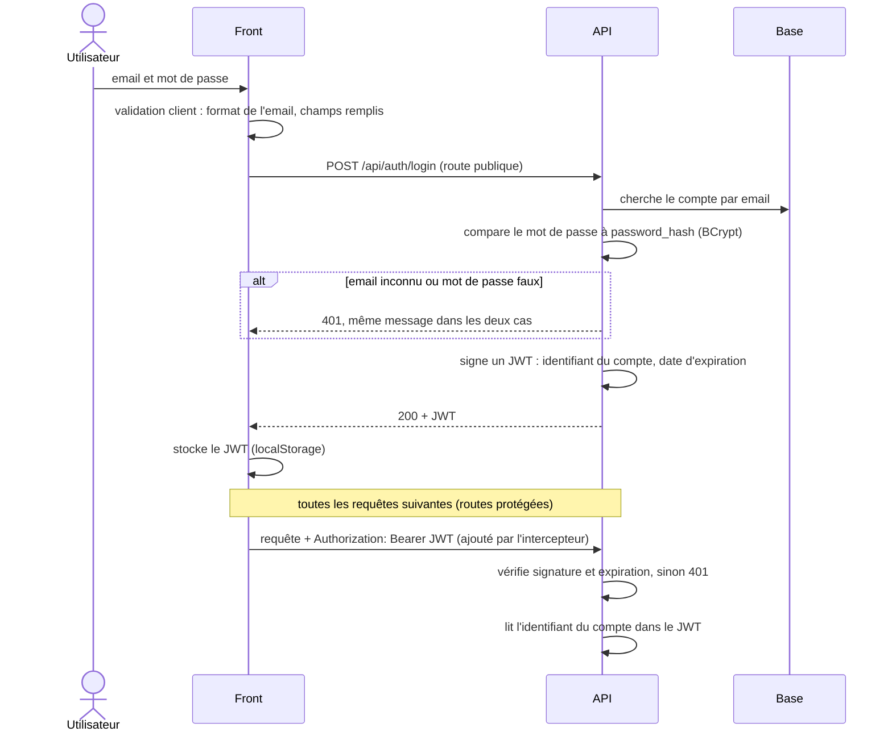
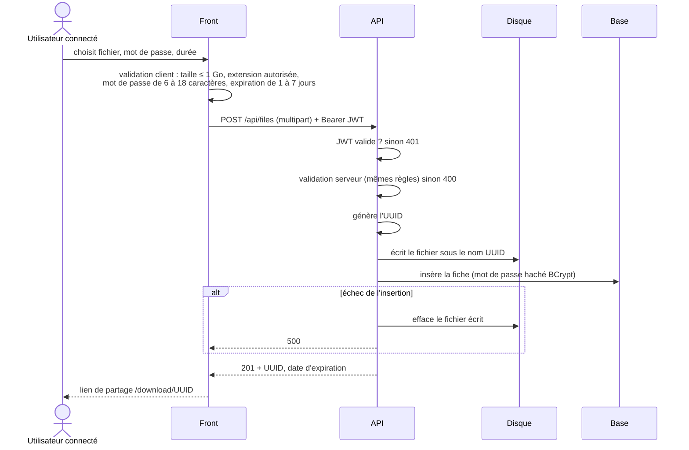
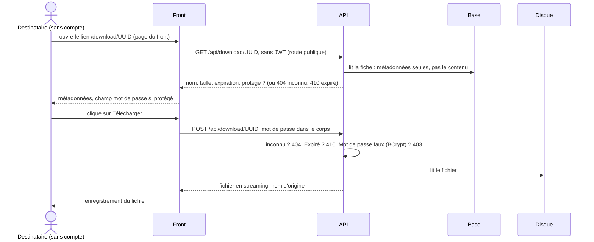
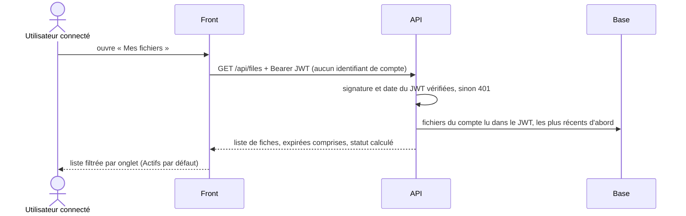
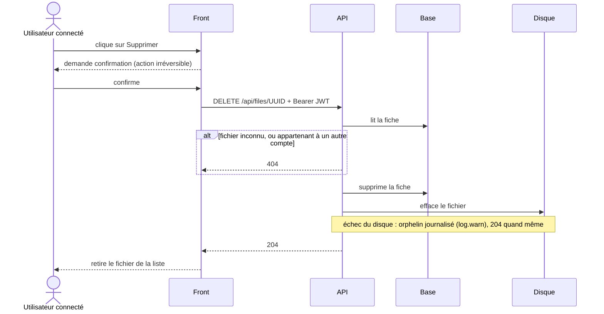

# Flux principaux

Comment les données circulent, user story par user story : qui appelle qui, dans quel
ordre, avec quels contrôles. Les briques et les couches sont décrites dans
[`architecture.md`](architecture.md) ; les routes, dans le
[contrat d'interface](contrat-interface.md).

| Flux | User stories |
|---|---|
| [Connexion](#connexion-us03-us04) | US03, US04 |
| [Upload](#upload-us01) | US01 |
| [Téléchargement](#téléchargement-us02) | US02 |
| [Historique](#historique-us05) | US05 |
| [Suppression](#suppression-us06) | US06 |
| [Expiration et purge](#expiration-et-purge-us01-us10-partielle) | US01, US10 partielle |

## Connexion (US03, US04)



L'identité vient **toujours du JWT**, jamais d'un paramètre : l'upload (US01),
l'historique (US05) et la suppression (US06) savent ainsi à qui ils répondent, sans qu'on puisse se faire
passer pour un autre compte. Détail par route : « D'où vient chaque donnée d'une requête ».
Un message identique pour « email inconnu » et « mot de
passe faux » évite de révéler quels emails sont inscrits.

### Le JWT et sa clé de signature

Un JWT a trois parties : `en-tête.contenu.signature`. Le contenu
(`{"sub": "42", "exp": …}`) est **encodé, pas chiffré** : n'importe qui peut le lire,
et l'utilisateur peut le modifier dans son navigateur (`"42"` → `"1"`).

La **clé de signature** (`JWT_SECRET`) sert à **authentifier le jeton comme émis
par notre back** : elle garantit son **origine** et son **intégrité** (personne ne l'a
modifié).

| Moment | Ce que fait Spring avec la clé |
|---|---|
| Connexion (US04) | `signature = HMAC-SHA256(contenu, clé)`, jointe au jeton |
| Chaque requête protégée | recalcule la signature du contenu reçu et la compare : différente → `401` ; identique → vérifie encore `exp` |

Le système complet : une clé, deux outils. Côté requête, le jeton n'est pas seulement
**décodé** (tout le monde peut lire du base64) mais **vérifié** : signature, puis `exp`.

```
                    JWT_SECRET (.env)
                         │
                   signingKey() ── clé HMAC-SHA256          (SpringSecurityConfig)
                    ┌────┴────┐
               JwtEncoder   JwtDecoder
                    │            │
connexion (US04) :  signe        │
  JwtService : sub = id du compte, exp = +1 h
                                 │
requête protégée : le filtre oauth2ResourceServer lit « Authorization: Bearer <jeton> »,
                   JwtDecoder vérifie la signature puis exp (tolérance de 60 s)
                     ├─ refusé ──► 401, corps vide, en-tête WWW-Authenticate
                     └─ accepté ──► Jwt remis au controller (@AuthenticationPrincipal) ──► id du compte
```

**Bearer** (« porteur ») : celui qui présente le jeton est authentifié, comme avec un
billet de concert. Le standard (RFC 6750) le place dans l'en-tête `Authorization` :

| Où placer le jeton | Problème |
|---|---|
| dans l'URL (`?token=…`) | finit dans les logs, l'historique du navigateur, l'en-tête `Referer` |
| dans un cookie | envoyé **automatiquement** par le navigateur, même quand un autre site déclenche la requête : attaque CSRF |
| **en-tête `Authorization`** | envoyé seulement par notre code (intercepteur du front) : pas de CSRF, d'où CSRF désactivé ; absent des URL |

Revers : quiconque vole le jeton peut s'en servir. Parades : HTTPS en production, durée
d'une heure, et la limite du stockage en `localStorage` notée dans `SECURITY.md`.

Modifier le contenu oblige à recalculer la signature, ce qui demande la clé. Celui qui
la détient peut donc se faire passer pour **n'importe quel compte** : elle reste sur le
serveur (`.env`, jamais versionné), et l'API refuse de démarrer sans elle. Le front ne
manipule que des jetons, jamais la clé.

Le reverse proxy et TLS ne remplacent pas ce contrôle : un jeton forgé voyage en HTTPS
comme un vrai, et seul le détenteur de la clé peut les distinguer.

HS256 est **symétrique** : la même clé signe et vérifie, ce qui convient à un back qui
fait les deux. Un service tiers qui devrait seulement vérifier les jetons demanderait
une paire de clés (RS256).

L'inscription (US03) suit le même chemin sans émettre de JWT : email unique vérifié,
mot de passe haché, réponse 201 ; l'utilisateur se connecte ensuite.

## Upload (US01)



### Format de la requête : `multipart/form-data`

Le corps est découpé en **parties** séparées par une frontière (*boundary*) ; chacune a
un nom et porte du texte ou des octets bruts. C'est ce qu'envoie un formulaire HTML avec
un champ fichier, et ce que construit `FormData` côté Angular.

```
POST /api/files
Authorization: Bearer eyJhbGci…
Content-Type: multipart/form-data; boundary=----XyZ

------XyZ
Content-Disposition: form-data; name="file"; filename="vacances.mp4"
Content-Type: video/mp4

<octets bruts du fichier>
------XyZ
Content-Disposition: form-data; name="password"

s3cret
------XyZ
Content-Disposition: form-data; name="expirationDays"

3
------XyZ--
```

**Écarté : JSON**, qui ne transporte que du texte : le fichier passerait en base64
(+33 %, 1 Go deviendrait 1,33 Go) et le corps se lirait d'un bloc.

| Étape | Qui |
|---|---|
| construire les parties ; **omettre** `password` s'il est vide (un `""` serait refusé : 6 caractères minimum) | `FileService` (front), avec `FormData` |
| écrire l'en-tête `Content-Type` avec sa frontière | le navigateur : le fixer à la main ferait perdre la frontière |
| découper les parties, écrire le fichier dans un dossier temporaire, refuser au-delà de 1 Go (`413`) | Tomcat et Spring (`application.properties`) |
| emballer la partie `file` dans un `MultipartFile` | Spring |
| remplir `UploadRequestDTO` **par nom de partie** | `@ModelAttribute` (et non `@RequestBody`, qui lit un seul corps JSON) |
| refuser un autre format (`415`) | `consumes = MULTIPART_FORM_DATA_VALUE` |

### Trajet de la requête dans le back

```
POST /api/files  (multipart + Authorization: Bearer <jeton>)
  │
  ├─ filtre JWT ── jeton absent, falsifié, expiré ? ──► 401 (corps vide)
  │
  ├─ Spring : fichier de plus de 1 Go ? ──► RestExceptionHandler ──► 413
  ▼
FileController ── @Valid sur UploadRequestDTO : mot de passe, durée, fichier absent ? ──► 400
  │   lit l'id du compte dans le jeton vérifié
  ▼
FileService ── nom ou extension invalide ? ──► InvalidFileException ──► RestExceptionHandler ──► 400
  ▼
201 + FileResponseDTO
```

Dans le back, `FileService.upload` enchaîne :

```
upload(requête, accountId)            ← accountId lu dans le JWT par le controller
 │
 ├─ 1. contrôle du nom : vide ou > 255 caractères ? extension interdite ?  ──► InvalidFileException → 400 (rien n'est écrit)
 ├─ 2. prépare la fiche : UUID tiré, propriétaire, nom, taille,
 │                        uploadedAt = maintenant, expiresAt = maintenant + durée (7 j par défaut),
 │                        hash du mot de passe s'il y en a un
 ├─ 3. disque : fileStorage.store(UUID, contenu)
 ├─ 4. base   : sharedFileRepository.save(fiche)
 │              └─ échec ? ──► fileStorage.delete(UUID), puis l'erreur d'origine remonte (500)
 └─ 5. fileMapper.toResponse(fiche) ──► FileResponseDTO (201)
```

Extensions refusées : exécutables Windows (`exe`, `com`, `msi`), scripts (`bat`, `cmd`,
`ps1`, `vbs`, `sh`) et archives Java exécutables (`jar`). Seule la dernière extension
compte, casse ignorée : `facture.pdf.EXE` est refusé, `archive.exe.zip` accepté.

Le fichier est écrit **en streaming** sur le disque, jamais chargé en entier en mémoire.
Spring refuse par défaut tout envoi de plus de 1 Mo : ce plafond est porté à
**1 Go**, la taille maximale autorisée par les spécifications.

## Téléchargement (US02)

Le destinataire **n'a pas de compte** : posséder le lien suffit (spec US02). C'est
l'expéditeur qui le lui transmet, par ses propres moyens (mail, messagerie), après
l'avoir copié sur l'écran « lien généré » ; l'application n'envoie aucun email.



Mot de passe en `POST`, **jamais dans l'URL** : une URL finit dans les logs du
serveur et l'historique du navigateur.

Ordre des contrôles, commun aux deux routes (décision du 2026-10-14) : inconnu, puis
expiré ; le mot de passe n'est vérifié qu'au `POST`. Le fichier n'est ouvert sur le
disque qu'**après** ces contrôles : une fois ouvert, plus rien ne peut échouer avant que
Spring l'envoie puis le ferme.

```
DownloadController ─► FileService.download ─► contrôles (404, 410, 403)
                                          └─► FileStorage.read : fichier ouvert, pas lu
       ◄── FileContentDTO (nom, taille, flux)
       └─► réponse : Content-Disposition (nom d'origine, UTF-8), application/octet-stream,
                     contenu copié par Spring morceau par morceau, puis flux fermé
```

Toujours `application/octet-stream`, quel que soit le fichier : avec l'en-tête `nosniff`,
le navigateur l'enregistre sans jamais l'afficher ni l'exécuter.

### Côté front : une page, trois états

La page `/download/:id` n'a pas de guard. Son état se déduit de deux signaux :
`metadata` (réponse du `GET`) et `unavailableMessage` (son échec).

| `metadata` | `unavailableMessage` | Affichage |
|---|---|---|
| vide | vide | « Chargement… » |
| rempli | — | nom, taille, avis d'expiration, champ mot de passe si protégé, bouton |
| vide | rempli | carte réduite au message : expiré (`410`), lien invalide (`404`, `400`), ou erreur générique (autre code) |

Un `400`, `404` ou `410` reçu **au clic** vide `metadata` : la page rejoint le même état
qu'au chargement. Un `403` laisse la page en place avec « Mot de passe incorrect. ».

```
DownloadService.download ─► Blob (fichier entier en mémoire)
  └─► saveFile(blob, originalName) : URL blob:, lien <a download> cliqué, URL libérée
```

Le nom vient des métadonnées, pas de `Content-Disposition` ; les erreurs sont lues par
leur code, le corps d'une erreur arrivant lui aussi en `Blob` (décisions du 2026-10-14).

## Historique (US05)



**Chaque couche fait une seule chose :**

| Couche | Rôle |
|---|---|
| `FileController` | lit l'identifiant du compte dans le JWT (`sub`) |
| `FileService.listOwnedBy` | convertit chaque fiche en DTO via `FileMapper` : statut calculé, hash jamais exposé |
| `SharedFileRepository` | `findByAccountIdOrderByUploadedAtDesc` : Spring Data génère `WHERE account_id = ? ORDER BY uploaded_at DESC` à partir du nom |

**Tri et filtre en base.** PostgreSQL ne renvoie que les fichiers du compte, déjà triés ;
l'index `idx_shared_file_account` sert le filtre. Le front n'a plus qu'à répartir la
liste entre les onglets, sans retrier.

**Côté front, un seul appel, filtré sur place.** La page garde la réponse de l'API et
en déduit la liste affichée :

```
files (signal : réponse de GET /api/files) ──┐
                                             ├── computed ──► visibleFiles ──► liste
filter (signal : onglet, « Actifs » au départ)┘
```

Changer d'onglet ne modifie que `filter` : aucune requête, l'ordre de l'API est gardé.
La **couleur** de l'échéance vient du `status` calculé par le back ; seul le **texte**
(« Expire demain ») est calculé par le front, avec `shared/expiry.ts`, comme sur la page
de téléchargement.

**Sécurité : le compte vient du jeton, jamais de la requête.** Il n'existe pas de
`GET /api/files?accountId=7` : l'URL ne contient aucun identifiant que l'utilisateur
pourrait changer. Le compte est le `sub` d'un JWT dont la signature est vérifiée ; le
modifier invalide la signature (voir « Le JWT et sa clé de signature »). Sans jeton
valide : `401`, avant même d'atteindre le controller.

## Suppression (US06)



Le fichier d'un autre compte reçoit la même réponse qu'un fichier inexistant : l'API
ne confirme pas son existence.

**Côté front, la ligne est retirée sans recharger la liste.** Le `204` suffit à savoir
que le fichier n'existe plus :

```
deleteFile ─► window.confirm ── annulé ──► rien
                  └── confirmé ─► FileService.delete ── 204 ──► files.update (ligne retirée) ──► visibleFiles suit
                                                     │           + « … a été supprimé. » (role="status")
                                                     └─ erreur ─► ligne gardée + message (role="alert")
```

Une ligne expirée garde « Supprimer » : la purge efface le fichier mais garde la fiche,
que l'utilisateur peut ainsi retirer de son historique (décision du 2026-10-14).

## Expiration et purge (US01, US10 partielle)

Le statut n'est **jamais stocké** : `FileMapper` le calcule à chaque conversion en
fiche (`FileResponseDTO`), en comparant `expires_at` à l'heure courante. Il vaut
`EXPIRING_SOON` quand il reste moins de 24 h.

| Quand | Qui | Effet |
|---|---|---|
| à chaque ouverture du lien (métadonnées et téléchargement) | `FileService` | `410` si `expires_at` est dépassée |
| à chaque fiche renvoyée (upload, historique) | `FileMapper` | statut `ACTIVE` · `EXPIRING_SOON` · `EXPIRED` |
| toutes les heures | `FilePurgeService` (`@Scheduled`) | efface du disque les fichiers expirés, **garde la fiche** |

La purge efface « si le fichier existe encore » : la relancer ne casse rien.

```
toutes les heures (cron datashare.purge.cron, variable PURGE_CRON)
  └─► FilePurgeService.purgeExpiredFiles
        ├─ SharedFileRepository.findByExpiresAtBefore(maintenant) ── WHERE expires_at < ?
        ├─ pour chaque fiche : FileStorage.delete(UUID)
        │     └─ échec ? log.warn avec l'UUID, on passe au suivant (retenté au passage suivant)
        └─ log.info : nombre de fiches traitées
```

| Choix | Raison |
|---|---|
| toutes les heures, pas une fois par nuit | Spring ne rattrape pas un passage manqué (veille, appli arrêtée) : sur un poste éteint la nuit, une purge à 3 h ne passerait jamais. Un serveur qui ne s'arrête pas peut revenir à une fois par jour (`PURGE_CRON=0 0 3 * * *`) |
| chaque passage reprend **toutes** les fiches expirées | aucun fichier oublié après un passage manqué. Revers : les fiches déjà purgées reviennent à chaque fois (effacement sans effet) ; perspective « Rétention des métadonnées » |
| un échec n'arrête pas la boucle | un fichier bloqué (droits) ne doit pas empêcher d'effacer les autres ; sa fiche reste, il est retenté |
| classe à part, pas dans `FileService` | `FileService` répond à un utilisateur (compte, JWT) ; la purge est une tâche d'exploitation, sans requête ni compte |
